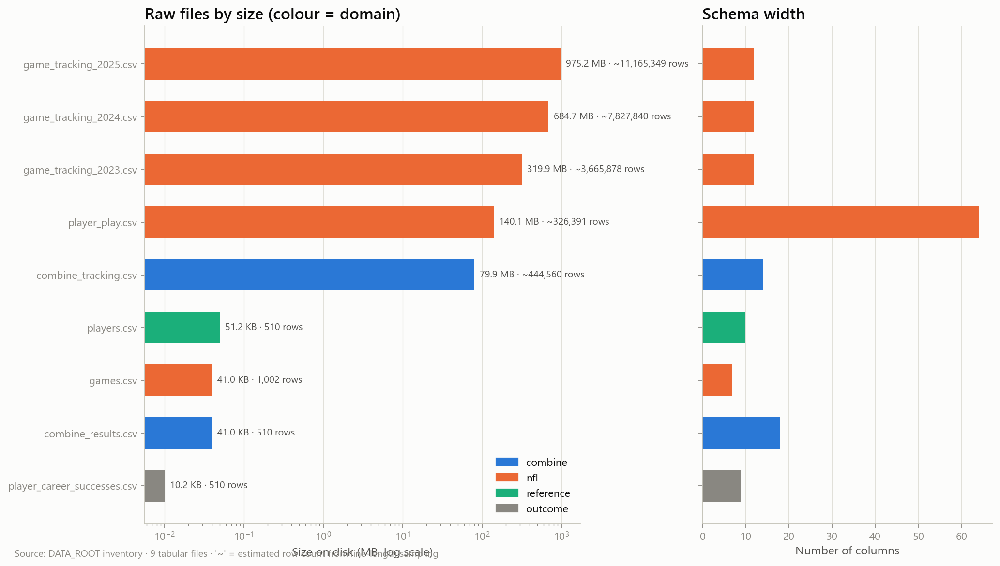

# 01 — Raw data inventory

_Step 1: metadata-only inspection with bounded samples_

_Generated 2026-10-08T00:33:01Z by `nflbdb.data` — numbers below come from executed code only._

## Summary

| item | value |
|---|---|
| Files discovered | 9 |
| Total size | 2.1 GB |
| Tabular files | 9 |
| Files outside registry | 0 |
| Files with schema drift vs registry | 0 |
| Estimated total rows | 23,432,550 (mix of estimated/exact — see table) |

## File inventory

| rel_path | format | size_mb | row_count | row_count_kind | n_columns | source | domain | partition_info | header_matches_spec |
|---|---|---|---|---|---|---|---|---|---|
| game_tracking_2025.csv | csv | 975.2 | 11,165,349 | estimated | 12 | game_tracking | nfl | season=2025 (from filename, registry rule) | True |
| game_tracking_2024.csv | csv | 684.7 | 7,827,840 | estimated | 12 | game_tracking | nfl | season=2024 (from filename, registry rule) | True |
| game_tracking_2023.csv | csv | 319.9 | 3,665,878 | estimated | 12 | game_tracking | nfl | season=2023 (from filename, registry rule) | True |
| player_play.csv | csv | 140.1 | 326,391 | estimated | 64 | player_play | nfl |  | True |
| combine_tracking.csv | csv | 79.91 | 444,560 | estimated | 14 | combine_tracking | combine |  | True |
| players.csv | csv | 0.05 | 510 | exact_sample | 10 | players | reference |  | True |
| combine_results.csv | csv | 0.04 | 510 | exact_sample | 18 | combine_results | combine |  | True |
| games.csv | csv | 0.04 | 1,002 | exact_sample | 7 | games | nfl |  | True |
| player_career_successes.csv | csv | 0.01 | 510 | exact_sample | 9 | player_career_successes | outcome |  | True |

## Read performance (bounded head sample) and full-scan estimate

| rel_path | sample_rows_read | sample_read_s | sample_read_peak_mb | sample_throughput_mb_s | est_full_scan_s |
|---|---|---|---|---|---|
| game_tracking_2025.csv | 50,000 | 0.146 | 9.6 | 30 | 32.5 |
| game_tracking_2024.csv | 50,000 | 0.139 | 11 | 31.4 | 21.8 |
| game_tracking_2023.csv | 50,000 | 0.164 | 11.3 | 26.5 | 12.1 |
| player_play.csv | 50,000 | 0.598 | 83.3 | 35.9 | 3.9 |
| combine_tracking.csv | 50,000 | 0.228 | 20.5 | 39.5 | 2 |
| combine_results.csv | 510 | 0.045 | 0.1 | 0.9 | 0 |
| games.csv | 1,002 | 0.011 | 0 | 3.7 | 0 |
| player_career_successes.csv | 510 | 0.005 | 0 | 2.5 | 0 |
| players.csv | 510 | 0.009 | 0 | 5.3 | 0 |

`est_full_scan_s` extrapolates the head-sample parse throughput to the whole file. It is a planning estimate for one single-pass CSV parse, not a benchmark (see 07_performance_benchmarks.md).

## Candidate keys and relationships (to be validated in 03/04)

| rel_path | candidate_keys | link_columns | related_files |
|---|---|---|---|
| combine_results.csv | nfl_id, draft_year + nfl_id | draft_year, nfl_id | combine_tracking.csv (via draft_year), combine_tracking.csv (via nfl_id), game_tracking_2023.csv (via nfl_id), game_tracking_2024.csv (via nfl_id), game_tracking_2025.csv (via nfl_id), player_career_successes.csv (via nfl_id), player_play.csv (via nfl_id), players.csv (via draft_year), players.csv (via nfl_id) |
| combine_tracking.csv | event_id + nfl_id + time, event_id + nfl_id + attempt + time | draft_year, event_id, nfl_id | combine_results.csv (via draft_year), combine_results.csv (via nfl_id), game_tracking_2023.csv (via nfl_id), game_tracking_2024.csv (via nfl_id), game_tracking_2025.csv (via nfl_id), player_career_successes.csv (via nfl_id), player_play.csv (via nfl_id), players.csv (via draft_year), players.csv (via nfl_id) |
| game_tracking_2023.csv | game_id + play_id + nfl_id + time | game_id, play_id, nfl_id | combine_results.csv (via nfl_id), combine_tracking.csv (via nfl_id), game_tracking_2024.csv (via game_id), game_tracking_2024.csv (via nfl_id), game_tracking_2024.csv (via play_id), game_tracking_2025.csv (via game_id), game_tracking_2025.csv (via nfl_id), game_tracking_2025.csv (via play_id), games.csv (via game_id), player_career_successes.csv (via nfl_id), player_play.csv (via game_id), player_play.csv (via nfl_id), player_play.csv (via play_id), players.csv (via nfl_id) |
| game_tracking_2024.csv | game_id + play_id + nfl_id + time | game_id, play_id, nfl_id | combine_results.csv (via nfl_id), combine_tracking.csv (via nfl_id), game_tracking_2023.csv (via game_id), game_tracking_2023.csv (via nfl_id), game_tracking_2023.csv (via play_id), game_tracking_2025.csv (via game_id), game_tracking_2025.csv (via nfl_id), game_tracking_2025.csv (via play_id), games.csv (via game_id), player_career_successes.csv (via nfl_id), player_play.csv (via game_id), player_play.csv (via nfl_id), player_play.csv (via play_id), players.csv (via nfl_id) |
| game_tracking_2025.csv | game_id + play_id + nfl_id + time | game_id, play_id, nfl_id | combine_results.csv (via nfl_id), combine_tracking.csv (via nfl_id), game_tracking_2023.csv (via game_id), game_tracking_2023.csv (via nfl_id), game_tracking_2023.csv (via play_id), game_tracking_2024.csv (via game_id), game_tracking_2024.csv (via nfl_id), game_tracking_2024.csv (via play_id), games.csv (via game_id), player_career_successes.csv (via nfl_id), player_play.csv (via game_id), player_play.csv (via nfl_id), player_play.csv (via play_id), players.csv (via nfl_id) |
| games.csv | game_id, game_key | game_id, game_key, season | game_tracking_2023.csv (via game_id), game_tracking_2024.csv (via game_id), game_tracking_2025.csv (via game_id), player_play.csv (via game_id) |
| player_career_successes.csv | nfl_id | nfl_id | combine_results.csv (via nfl_id), combine_tracking.csv (via nfl_id), game_tracking_2023.csv (via nfl_id), game_tracking_2024.csv (via nfl_id), game_tracking_2025.csv (via nfl_id), player_play.csv (via nfl_id), players.csv (via nfl_id) |
| player_play.csv | game_id + play_id + nfl_id | game_id, play_id, nfl_id | combine_results.csv (via nfl_id), combine_tracking.csv (via nfl_id), game_tracking_2023.csv (via game_id), game_tracking_2023.csv (via nfl_id), game_tracking_2023.csv (via play_id), game_tracking_2024.csv (via game_id), game_tracking_2024.csv (via nfl_id), game_tracking_2024.csv (via play_id), game_tracking_2025.csv (via game_id), game_tracking_2025.csv (via nfl_id), game_tracking_2025.csv (via play_id), games.csv (via game_id), player_career_successes.csv (via nfl_id), players.csv (via nfl_id) |
| players.csv | nfl_id | nfl_id, draft_year | combine_results.csv (via draft_year), combine_results.csv (via nfl_id), combine_tracking.csv (via draft_year), combine_tracking.csv (via nfl_id), game_tracking_2023.csv (via nfl_id), game_tracking_2024.csv (via nfl_id), game_tracking_2025.csv (via nfl_id), player_career_successes.csv (via nfl_id), player_play.csv (via nfl_id) |

## Partitioning opportunities

| rel_path | partition_info |
|---|---|
| game_tracking_2023.csv | season=2023 (from filename, registry rule) |
| game_tracking_2024.csv | season=2024 (from filename, registry rule) |
| game_tracking_2025.csv | season=2025 (from filename, registry rule) |

- Game tracking is already split by season in the raw files → natural `season=` Hive partition.
- Combine tracking carries `draft_year` → candidate `draft_year=` partition (low cardinality).
- Do NOT partition by `nfl_id`, `game_id` or `play_id` (high cardinality → many tiny files); sort by key inside partitions instead so Parquet row-group statistics enable pruning.

## Schema drift vs registry

All headers match `sources.py`.
