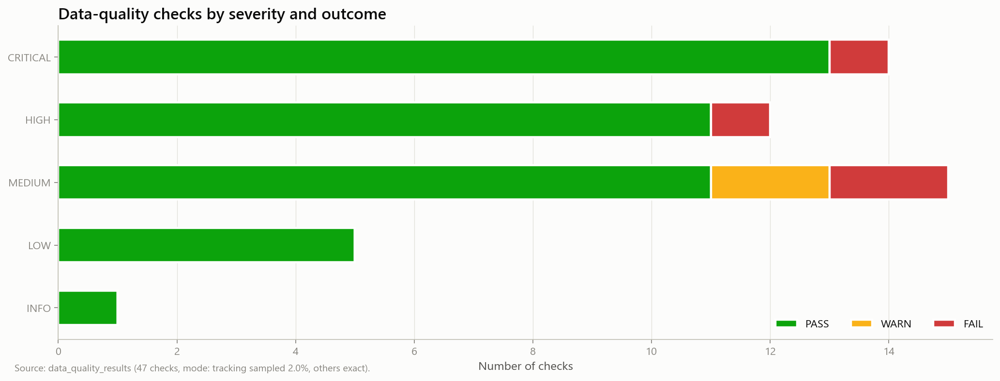

# 03 — Data quality

_Step 3: bounded profiling (Pass A) + targeted validation (Pass B, tracking sampled 2.0%, others exact)_

_Generated 2026-10-08T00:36:01Z by `nflbdb.data` — numbers below come from executed code only._

## Summary

| result | len |
|---|---|
| FAIL | 4 |
| PASS | 55 |
| WARN | 3 |

> [!CAUTION]
> 2 CRITICAL/HIGH check(s) failed — see below before trusting joins.

## Quality results

| check | table | columns | result | severity | details | recommended_action | mode |
|---|---|---|---|---|---|---|---|
| Key uniqueness | combine_tracking | event_id, nfl_id, attempt, time | FAIL | CRITICAL | 16 duplicate-key rows of 9,317 (9,301 distinct keys) | If FAIL: inspect with duplicate_examples(); refine grain or dedup in silver with a documented rule. | sample 2.0% (finds issues, cannot prove absence) |
| Timestamp parse | game_tracking | time | PASS | CRITICAL | 0 unparseable timestamps; range 2023-08-04T00:12:45.500 → 2026-02-09T03:22:50.300 | Silver aborts on unparseable timestamps; fix the format string. | sample 2.0% (finds issues, cannot prove absence) |
| Frame consistency: unparseable timestamps | combine_tracking | n_null_ts | PASS | CRITICAL | 0 of 9,654 (0.0000%) over 141 trajectories | Fix timestamp parsing before silver. | sample 2.0% of trajectories |
| Frame consistency: unparseable timestamps | game_tracking | n_null_ts | PASS | CRITICAL | 0 of 452,714 (0.0000%) over 6,307 trajectories | Fix timestamp parsing before silver. | sample 2.0% of trajectories |
| Key uniqueness | combine_results | draft_year, nfl_id | PASS | CRITICAL | 0 duplicate-key rows of 510 (510 distinct keys) | If FAIL: inspect with duplicate_examples(); refine grain or dedup in silver with a documented rule. | exact |
| Key uniqueness | players | nfl_id | PASS | CRITICAL | 0 duplicate-key rows of 510 (510 distinct keys) | If FAIL: inspect with duplicate_examples(); refine grain or dedup in silver with a documented rule. | exact |
| Referential integrity | player_play | (game_id) → games(game_id) | PASS | CRITICAL | 0 of 1,001 distinct child keys have no parent (0.00%) | Investigate orphans; never repair by name matching. Keep orphans flagged in silver. | exact |
| Key uniqueness | game_tracking | game_id, play_id, nfl_id, time | PASS | CRITICAL | 0 duplicate-key rows of 453,747 (453,747 distinct keys) | If FAIL: inspect with duplicate_examples(); refine grain or dedup in silver with a documented rule. | sample 2.0% (finds issues, cannot prove absence) |
| Key uniqueness | games | game_key | PASS | CRITICAL | 0 duplicate-key rows of 1,002 (1,002 distinct keys) | If FAIL: inspect with duplicate_examples(); refine grain or dedup in silver with a documented rule. | exact |
| Referential integrity | game_tracking | (game_id) → games(game_id) | PASS | CRITICAL | 0 of 1,001 distinct child keys have no parent (0.00%) | Investigate orphans; never repair by name matching. Keep orphans flagged in silver. | sample 2.0% (finds issues, cannot prove absence) |
| Key uniqueness | player_play | game_id, play_id, nfl_id | PASS | CRITICAL | 0 duplicate-key rows of 314,197 (314,197 distinct keys) | If FAIL: inspect with duplicate_examples(); refine grain or dedup in silver with a documented rule. | exact |
| Missing identifier | player_play | game_id, play_id, nfl_id | PASS | CRITICAL | 0.0000% rows with a null in (game_id, play_id, nfl_id) where TRUE | Rows without identifiers cannot be linked; quarantine or document (e.g. football rows). | exact |
| Key uniqueness | player_career_successes | nfl_id | PASS | CRITICAL | 0 duplicate-key rows of 510 (510 distinct keys) | If FAIL: inspect with duplicate_examples(); refine grain or dedup in silver with a documented rule. | exact |
| Timestamp parse | combine_tracking | time | PASS | CRITICAL | 0 unparseable timestamps; range 2023-03-02T20:11:23.400 → 2025-03-02T21:22:12.600 | Silver aborts on unparseable timestamps; fix the format string. | sample 2.0% (finds issues, cannot prove absence) |
| Missing identifier | game_tracking | game_id, play_id, time | PASS | CRITICAL | 0.0000% rows with a null in (game_id, play_id, time) where TRUE | Rows without identifiers cannot be linked; quarantine or document (e.g. football rows). | sample 2.0% (finds issues, cannot prove absence) |
| Missing identifier | combine_tracking | event_id, time | PASS | CRITICAL | 0.0000% rows with a null in (event_id, time) where TRUE | Rows without identifiers cannot be linked; quarantine or document (e.g. football rows). | sample 2.0% (finds issues, cannot prove absence) |
| Referential integrity | game_tracking | (game_id,play_id) → player_play(game_id,play_id) | FAIL | HIGH | 150 of 104,545 distinct child keys have no parent (0.14%) | Investigate orphans; never repair by name matching. Keep orphans flagged in silver. | sample 2.0% (finds issues, cannot prove absence) |
| Referential integrity | player_career_successes | (nfl_id) → players(nfl_id) | PASS | HIGH | 0 of 510 distinct child keys have no parent (0.00%) | Investigate orphans; never repair by name matching. Keep orphans flagged in silver. | exact |
| Exact duplicate rows | player_play | *all source columns* | PASS | HIGH | 0 fully identical rows | Identical rows are safe to drop in silver (keep lowest _src_row). | exact |
| Frame consistency: duplicate timestamps | combine_tracking | n_dup_ts | PASS | HIGH | 0 of 9,654 (0.0000%) over 141 trajectories | Dedup exact duplicates in silver; investigate conflicting duplicates. | sample 2.0% of trajectories |
| Exact duplicate rows | combine_results | *all source columns* | PASS | HIGH | 0 fully identical rows | Identical rows are safe to drop in silver (keep lowest _src_row). | exact |
| Frame consistency: duplicate timestamps | game_tracking | n_dup_ts | PASS | HIGH | 0 of 452,714 (0.0000%) over 6,307 trajectories | Dedup exact duplicates in silver; investigate conflicting duplicates. | sample 2.0% of trajectories |
| Exact duplicate rows | games | *all source columns* | PASS | HIGH | 0 fully identical rows | Identical rows are safe to drop in silver (keep lowest _src_row). | exact |
| Referential integrity | combine_tracking | (nfl_id) → players(nfl_id) | PASS | HIGH | 0 of 510 distinct child keys have no parent (0.00%) | Investigate orphans; never repair by name matching. Keep orphans flagged in silver. | sample 2.0% (finds issues, cannot prove absence) |
| Referential integrity | combine_results | (nfl_id) → players(nfl_id) | PASS | HIGH | 0 of 510 distinct child keys have no parent (0.00%) | Investigate orphans; never repair by name matching. Keep orphans flagged in silver. | exact |
| Partition consistency | game_tracking | season (filename) vs games.season | PASS | HIGH | 0 of 1,001 tracked games where filename season ≠ games.season | Use games.season as the authoritative season in silver. | sample 2.0% (finds issues, cannot prove absence) |
| Exact duplicate rows | player_career_successes | *all source columns* | PASS | HIGH | 0 fully identical rows | Identical rows are safe to drop in silver (keep lowest _src_row). | exact |
| Missing identifier | combine_tracking | nfl_id | PASS | HIGH | 0.0000% rows with a null in (nfl_id) where entity_type = 'PLAYER' | Rows without identifiers cannot be linked; quarantine or document (e.g. football rows). | sample 2.0% (finds issues, cannot prove absence) |
| Allowed values | player_play | play_direction | PASS | HIGH | 0 values not in ['left', 'right']; examples=None | Extend the domain or map values in silver. | exact |
| Exact duplicate rows | players | *all source columns* | PASS | HIGH | 0 fully identical rows | Identical rows are safe to drop in silver (keep lowest _src_row). | exact |
| Referential integrity | game_tracking | (game_id,play_id,nfl_id) → player_play(game_id,play_id,nfl_id) | FAIL | MEDIUM | 1,879 of 237,177 distinct child keys have no parent (0.79%) | Tracked players absent from player_play lose play context. | sample 2.0% (finds issues, cannot prove absence) |
| Key uniqueness | combine_tracking | event_id, nfl_id, time | FAIL | MEDIUM | 16 duplicate-key rows of 9,317 (9,301 distinct keys) | If FAIL: inspect with duplicate_examples(); refine grain or dedup in silver with a documented rule. | sample 2.0% (finds issues, cannot prove absence) |
| Frame consistency: non-monotonic time (file order) | combine_tracking | n_nonmono | PASS | MEDIUM | 0 of 9,654 (0.0000%) over 141 trajectories | Always ORDER BY ts in silver; never rely on file order. | sample 2.0% of trajectories |
| Identifier/time consistency | game_tracking | game_id date vs time | PASS | MEDIUM | 0 games whose first timestamp is > 1 day from the game_id date | If WARN: game_id namespace differs from date encoding, or timestamps are shifted. | sample 2.0% (finds issues, cannot prove absence) |
| Trajectory: speed above plausibility | combine_tracking | n_speed_gt_max | PASS | MEDIUM | 0 of 9,654 (0.0000%) over 141 trajectories | Flag; use robust peaks (e.g. p99 or sustained 0.5 s max). | sample 2.0% of trajectories |
| Trajectory: implausible jumps | combine_tracking | n_jumps | PASS | MEDIUM | 0 of 9,654 (0.0000%) over 141 trajectories | Flag frames; exclude from peak-speed features or smooth. | sample 2.0% of trajectories |
| Frame consistency: gaps (missing frames) | combine_tracking | n_gaps | PASS | MEDIUM | 0 of 9,654 (0.0000%) over 141 trajectories | Keep gaps; derived kinematics must use true Δt, not frame counts. | sample 2.0% of trajectories |
| Key uniqueness | combine_results | nfl_id | PASS | MEDIUM | 0 duplicate-key rows of 510 (510 distinct keys) | If FAIL: inspect with duplicate_examples(); refine grain or dedup in silver with a documented rule. | exact |
| Referential integrity | combine_tracking | (nfl_id) → combine_results(nfl_id) | PASS | MEDIUM | 0 of 510 distinct child keys have no parent (0.00%) | Tracked athletes without traditional results limit baseline comparisons. | sample 2.0% (finds issues, cannot prove absence) |
| Value range | game_tracking | x | PASS | MEDIUM | 0 values outside [-10.0, 130.0] (0.0000%); observed min=-5.26, max=127.21 | Flag (do not delete) in silver; inspect extreme rows. | sample 2.0% (finds issues, cannot prove absence) |
| Value range | game_tracking | a | PASS | MEDIUM | 0 values outside [0, 15.0] (0.0000%); observed min=0.0, max=11.59 | Flag (do not delete) in silver; inspect extreme rows. | sample 2.0% (finds issues, cannot prove absence) |
| Referential integrity | game_tracking | (nfl_id) → players(nfl_id) | PASS | MEDIUM | 0 of 497 distinct child keys have no parent (0.00%) | Expected to fail partially if players.csv only covers drafted cohorts. | sample 2.0% (finds issues, cannot prove absence) |
| Key uniqueness | games | game_id | PASS | MEDIUM | 0 duplicate-key rows of 1,002 (1,002 distinct keys) | If FAIL: inspect with duplicate_examples(); refine grain or dedup in silver with a documented rule. | exact |
| Referential integrity | player_play | (nfl_id) → players(nfl_id) | PASS | MEDIUM | 0 of 497 distinct child keys have no parent (0.00%) | Investigate orphans; never repair by name matching. Keep orphans flagged in silver. | exact |
| Allowed values | combine_tracking | entity_type | PASS | MEDIUM | 0 values not in ['PLAYER', 'BALL']; examples=None | Extend the domain or map values in silver. | sample 2.0% (finds issues, cannot prove absence) |
| Value range | game_tracking | s | PASS | MEDIUM | 3 values outside [0, 12.5] (0.0007%); observed min=0.0, max=15.22 | Flag (do not delete) in silver; inspect extreme rows. | sample 2.0% (finds issues, cannot prove absence) |
| Frame consistency: non-monotonic time (file order) | game_tracking | n_nonmono | PASS | MEDIUM | 0 of 452,714 (0.0000%) over 6,307 trajectories | Always ORDER BY ts in silver; never rely on file order. | sample 2.0% of trajectories |
| Value range | game_tracking | y | PASS | MEDIUM | 0 values outside [-10.0, 63.3] (0.0000%); observed min=-7.05, max=62.7 | Flag (do not delete) in silver; inspect extreme rows. | sample 2.0% (finds issues, cannot prove absence) |
| Frame consistency: gaps (missing frames) | game_tracking | n_gaps | PASS | MEDIUM | 0 of 452,714 (0.0000%) over 6,307 trajectories | Keep gaps; derived kinematics must use true Δt, not frame counts. | sample 2.0% of trajectories |
| Trajectory: speed above plausibility | game_tracking | n_speed_gt_max | PASS | MEDIUM | 0 of 452,714 (0.0000%) over 6,307 trajectories | Flag; use robust peaks (e.g. p99 or sustained 0.5 s max). | sample 2.0% of trajectories |
| Value range | combine_tracking | s | WARN | MEDIUM | 177 values outside [0, 12.5] (1.8998%); observed min=0.006666667, max=25.56108348 | Flag (do not delete) in silver; inspect extreme rows. | sample 2.0% (finds issues, cannot prove absence) |
| Value range | combine_tracking | a | WARN | MEDIUM | 3 values outside [0, 15.0] (0.0322%); observed min=0.0, max=23.99292835 | Flag (do not delete) in silver; inspect extreme rows. | sample 2.0% (finds issues, cannot prove absence) |
| Trajectory: implausible jumps | game_tracking | n_jumps | WARN | MEDIUM | 4 of 452,714 (0.0009%) over 6,307 trajectories | Flag frames; exclude from peak-speed features or smooth. | sample 2.0% of trajectories |
| Value range | game_tracking | dir | PASS | LOW | 0 values outside [0, 360] (0.0000%); observed min=0.0, max=360.0 | Flag (do not delete) in silver; inspect extreme rows. | sample 2.0% (finds issues, cannot prove absence) |
| Coordinates: outside field (+tolerance) | game_tracking | n_out_of_bounds | PASS | LOW | 0 of 452,714 (0.0000%) over 6,307 trajectories | Flag; players legitimately leave the field on sidelines. | sample 2.0% of trajectories |
| Trajectory: acceleration above plausibility | game_tracking | n_accel_gt_max | PASS | LOW | 0 of 452,714 (0.0000%) over 6,307 trajectories | Flag; prefer smoothed acceleration features. | sample 2.0% of trajectories |
| Value range | combine_results | forty | PASS | LOW | 0 values outside [4.0, 6.5] (0.0000%); observed min=4.28, max=5.48 | Flag (do not delete) in silver; inspect extreme rows. | exact |
| Value range | game_tracking | o | PASS | LOW | 0 values outside [0, 360] (0.0000%); observed min=0.0, max=360.0 | Flag (do not delete) in silver; inspect extreme rows. | sample 2.0% (finds issues, cannot prove absence) |
| Value range | combine_results | combine_weight | PASS | LOW | 0 values outside [150, 400] (0.0000%); observed min=154.0, max=374.0 | Flag (do not delete) in silver; inspect extreme rows. | exact |
| Value range | combine_results | combine_height | PASS | LOW | 0 values outside [60, 84] (0.0000%); observed min=68.125, max=80.625 | Flag (do not delete) in silver; inspect extreme rows. | exact |
| Trajectory: acceleration above plausibility | combine_tracking | n_accel_gt_max | PASS | LOW | 0 of 9,654 (0.0000%) over 141 trajectories | Flag; prefer smoothed acceleration features. | sample 2.0% of trajectories |
| Null share | game_tracking | nfl_id | PASS | INFO | 0.0000% null | Document meaning of nulls. | sample 2.0% (finds issues, cannot prove absence) |

## Pass A — column profiles

Full per-column profile: `reports/tables/profile_summary.csv` (approx_unique = HyperLogLog estimate).

| table | column_name | column_type | min | max | approx_unique | null_percentage | profile_mode |
|---|---|---|---|---|---|---|---|
| players | _src_row | UINTEGER | 0 | 509 | 544 | 0 | exact (full table) |
| players | nfl_id | BIGINT | 55867 | 59278 | 458 | 0 | exact (full table) |
| players | display_name | VARCHAR | A.J. Barner | Zy Alexander | 526 | 0 | exact (full table) |
| players | draft_year | BIGINT | 2023 | 2025 | 3 | 0 | exact (full table) |
| players | nfl_position | VARCHAR | C | WR | 20 | 0 | exact (full table) |
| players | birth_date | VARCHAR | 1997-12-12 | 2004-08-25 | 440 | 0 | exact (full table) |
| players | college_name | VARCHAR | Alabama | Wyoming | 129 | 0 | exact (full table) |
| players | college_conference | VARCHAR | American Athletic Conference | United Athletic Conference | 20 | 0 | exact (full table) |
| players | draft_round | DOUBLE | 1.0 | 7.0 | 7 | 24.9 | exact (full table) |
| players | draft_pick_within_round | DOUBLE | 1.0 | 43.0 | 43 | 24.9 | exact (full table) |
| players | draft_overall_pick | DOUBLE | 3.0 | 257.0 | 260 | 24.9 | exact (full table) |
| combine_results | _src_row | UINTEGER | 0 | 509 | 544 | 0 | exact (full table) |
| combine_results | draft_year | BIGINT | 2023 | 2025 | 3 | 0 | exact (full table) |
| combine_results | nfl_id | BIGINT | 55867 | 59278 | 458 | 0 | exact (full table) |
| combine_results | combine_position | VARCHAR | DB | WR | 5 | 0 | exact (full table) |
| combine_results | combine_height | DOUBLE | 68.125 | 80.625 | 91 | 0 | exact (full table) |
| combine_results | combine_weight | DOUBLE | 154.0 | 374.0 | 128 | 0 | exact (full table) |
| combine_results | hand_size | DOUBLE | 8.0 | 11.625 | 27 | 0 | exact (full table) |
| combine_results | arm_length | DOUBLE | 28.5 | 36.875 | 60 | 0 | exact (full table) |
| combine_results | wing_span | DOUBLE | 69.0 | 88.25 | 100 | 0 | exact (full table) |
| combine_results | ten_yd_split | DOUBLE | 1.46 | 1.96 | 48 | 16.67 | exact (full table) |
| combine_results | forty | DOUBLE | 4.28 | 5.48 | 97 | 16.86 | exact (full table) |
| combine_results | vertical | DOUBLE | 23.0 | 44.0 | 42 | 14.12 | exact (full table) |
| combine_results | broad_jump | DOUBLE | 93.0 | 138.0 | 51 | 17.06 | exact (full table) |
| combine_results | three_cone | DOUBLE | 6.57 | 8.19 | 85 | 64.71 | exact (full table) |
| combine_results | short_shuttle | DOUBLE | 3.93 | 5.03 | 102 | 60.59 | exact (full table) |
| combine_results | bench_reps | DOUBLE | 8.0 | 39.0 | 24 | 62.35 | exact (full table) |
| combine_results | ngs_athleticism_score | DOUBLE | 51.0 | 99.0 | 61 | 0 | exact (full table) |
| combine_results | ngs_college_production_score | DOUBLE | 50.0 | 99.0 | 53 | 0.2 | exact (full table) |
| combine_results | ngs_final_score | DOUBLE | 52.0 | 94.0 | 54 | 0.2 | exact (full table) |
| combine_tracking | _src_row | UINTEGER | 81 | 463140 | 10,711 | 0 | sample 2.0% bernoulli seed=42 |
| combine_tracking | draft_year | BIGINT | 2023 | 2025 | 3 | 0 | sample 2.0% bernoulli seed=42 |
| combine_tracking | event_id | VARCHAR | 20240229100000_1709237434916_000 | 6414e6d3e3d8e72dcdcd0487-2023 | 4,021 | 0 | sample 2.0% bernoulli seed=42 |
| combine_tracking | nfl_id | BIGINT | 55867 | 59278 | 458 | 0 | sample 2.0% bernoulli seed=42 |
| combine_tracking | entity_type | VARCHAR | BALL | PLAYER | 2 | 0 | sample 2.0% bernoulli seed=42 |
| combine_tracking | time | VARCHAR | 2023-03-02T20:11:23.400 | 2025-03-02T21:22:12.600 | 10,252 | 0 | sample 2.0% bernoulli seed=42 |
| combine_tracking | drill_type | VARCHAR | FORTY_YARD_DASH | THREE_CONE_DRILL | 9 | 0 | sample 2.0% bernoulli seed=42 |
| combine_tracking | drill_name | VARCHAR | BACK_PEDAL_AND_90_DEGREE_BREAK_TO_BALL | W_DRILL | 75 | 0 | sample 2.0% bernoulli seed=42 |
| combine_tracking | attempt | BIGINT | 1 | 17 | 18 | 0 | sample 2.0% bernoulli seed=42 |
| combine_tracking | x | DOUBLE | 3.4 | 101.8666667 | 5,363 | 0 | sample 2.0% bernoulli seed=42 |
| combine_tracking | y | DOUBLE | -7.031775792 | 62.47080994 | 4,978 | 0 | sample 2.0% bernoulli seed=42 |
| combine_tracking | s | DOUBLE | 0.006666667 | 25.56108348 | 5,867 | 0 | sample 2.0% bernoulli seed=42 |
| combine_tracking | a | DOUBLE | 0.0 | 23.99292835 | 6,892 | 0 | sample 2.0% bernoulli seed=42 |
| combine_tracking | dis | DOUBLE | 0.0 | 20.50649249 | 4,325 | 0 | sample 2.0% bernoulli seed=42 |
| combine_tracking | dir | DOUBLE | 0.0 | 359.9784926 | 8,889 | 0 | sample 2.0% bernoulli seed=42 |
| game_tracking | _src_row | UINTEGER | 35 | 11160833 | 433,188 | 0 | sample 2.0% bernoulli seed=42 |
| game_tracking | game_id | BIGINT | 2023080351 | 2026020800 | 1,082 | 0 | sample 2.0% bernoulli seed=42 |
| game_tracking | play_id | BIGINT | 54 | 5463 | 5,506 | 0 | sample 2.0% bernoulli seed=42 |
| game_tracking | nfl_id | BIGINT | 55867 | 59278 | 457 | 0 | sample 2.0% bernoulli seed=42 |
| game_tracking | time | VARCHAR | 2023-08-04T00:12:45.500 | 2026-02-09T03:22:50.300 | 413,751 | 0 | sample 2.0% bernoulli seed=42 |
| game_tracking | x | DOUBLE | -5.26 | 127.21 | 8,624 | 0 | sample 2.0% bernoulli seed=42 |
| game_tracking | y | DOUBLE | -7.05 | 62.7 | 5,084 | 0 | sample 2.0% bernoulli seed=42 |
| game_tracking | s | DOUBLE | 0.0 | 15.22 | 1,149 | 0 | sample 2.0% bernoulli seed=42 |
| game_tracking | a | DOUBLE | 0.0 | 11.59 | 726 | 0 | sample 2.0% bernoulli seed=42 |
| game_tracking | dis | DOUBLE | 0.0 | 2.08 | 112 | 0 | sample 2.0% bernoulli seed=42 |
| game_tracking | o | DOUBLE | 0.0 | 360.0 | 34,875 | 0 | sample 2.0% bernoulli seed=42 |
| game_tracking | dir | DOUBLE | 0.0 | 360.0 | 34,875 | 0 | sample 2.0% bernoulli seed=42 |
| game_tracking | event | VARCHAR | autoevent_passinterrupted | two_point_conversion | 35 | 93.34 | sample 2.0% bernoulli seed=42 |
| game_tracking | season | BIGINT | 2023 | 2025 | 3 | 0 | sample 2.0% bernoulli seed=42 |
| games | _src_row | UINTEGER | 0 | 1001 | 1,249 | 0 | exact (full table) |
| games | game_id | BIGINT | 2023080351 | 2026020800 | 1,082 | 0 | exact (full table) |
| games | game_key | BIGINT | 59173 | 60176 | 874 | 0 | exact (full table) |
| games | season | BIGINT | 2023 | 2025 | 3 | 0 | exact (full table) |
| games | season_type | VARCHAR | POST | REG | 3 | 0 | exact (full table) |
| games | week | BIGINT | 0 | 23 | 23 | 0 | exact (full table) |
| games | home_team_abbr | VARCHAR | ARI | WAS | 36 | 0 | exact (full table) |
| games | visitor_team_abbr | VARCHAR | ARI | WAS | 36 | 0 | exact (full table) |
| player_play | _src_row | UINTEGER | 0 | 314196 | 301,026 | 0 | exact (full table) |
| player_play | game_id | BIGINT | 2023080351 | 2026020800 | 1,082 | 0 | exact (full table) |
| player_play | play_id | BIGINT | 54 | 5463 | 5,506 | 0 | exact (full table) |
| player_play | team_abbr | VARCHAR | ARI | WAS | 36 | 0 | exact (full table) |
| player_play | nfl_id | BIGINT | 55867 | 59278 | 457 | 0 | exact (full table) |
| player_play | lined_up_position | VARCHAR | BOX_SAFETY | WR | 20 | 0.44 | exact (full table) |
| player_play | play_description | VARCHAR | (10:00) (No Huddle) J.Brissett up the middle to SF 34 for no gain (N.Bosa). ** Injury Update: SF-J.Elliott has returned to the game.  PENALTY on SF, Defensive Too Many Men on Field, 5 yards, enforced at SF 34 - No Play. | TWO-POINT CONVERSION ATTEMPT. Z.Wilson pass to A.Shampklin is incomplete. ATTEMPT FAILS. | 126,394 | 0 | exact (full table) |
| player_play | quarter | DOUBLE | 1.0 | 5.0 | 5 | 0 | exact (full table) |
| player_play | down | DOUBLE | 0.0 | 4.0 | 5 | 0 | exact (full table) |
| player_play | yards_to_go | DOUBLE | 0.0 | 40.0 | 43 | 0 | exact (full table) |
| player_play | possession_team | VARCHAR | ARI | WAS | 36 | 0 | exact (full table) |
| player_play | yardline_side | VARCHAR | ARI | WAS | 36 | 1.31 | exact (full table) |
| player_play | yardline_number | DOUBLE | 1.0 | 50.0 | 54 | 0 | exact (full table) |
| player_play | game_clock | VARCHAR | 00:00 | 15:00 | 885 | 0 | exact (full table) |
| player_play | pre_snap_home_score | DOUBLE | 0.0 | 70.0 | 58 | 0 | exact (full table) |
| player_play | pre_snap_visitor_score | DOUBLE | 0.0 | 51.0 | 45 | 0 | exact (full table) |
| player_play | play_direction | VARCHAR | left | right | 2 | 0.02 | exact (full table) |
| player_play | pre_snap_home_team_win_probability | DOUBLE | 0.000759521470172331 | 0.99995 | 111,029 | 0 | exact (full table) |
| player_play | pre_snap_visitor_team_win_probability | DOUBLE | 4.99999999999945e-05 | 0.999240478529828 | 127,644 | 0 | exact (full table) |
| player_play | home_team_win_probability_added | DOUBLE | -0.992924490012228 | 0.993080163316336 | 136,459 | 0 | exact (full table) |
| player_play | visitor_team_win_probility_added | DOUBLE | -0.993080163316336 | 0.992924490012228 | 136,339 | 0 | exact (full table) |
| player_play | expected_points_added | DOUBLE | -12.8963822780643 | 8.96881306264549 | 112,072 | 0 | exact (full table) |
| player_play | expected_points | DOUBLE | -2.89999428391457 | 6.65668764384463 | 111,429 | 0 | exact (full table) |
| player_play | offense_formation | VARCHAR | EMPTY | WILDCAT | 7 | 1.7 | exact (full table) |
| player_play | receiver_alignment | VARCHAR | 0x0 | 5x2 | 16 | 1.46 | exact (full table) |
| player_play | pass_result | VARCHAR |  | S | 5 | 0 | exact (full table) |
| player_play | pass_length | DOUBLE | -70.0 | 65.0 | 94 | 41.2 | exact (full table) |
| player_play | play_nullified_by_penalty | VARCHAR | N | Y | 2 | 0 | exact (full table) |
| player_play | penalty_yards | DOUBLE | -25.0 | 52.0 | 66 | 93.4 | exact (full table) |
| player_play | pre_penalty_yards_gained | DOUBLE | -28.0 | 98.0 | 133 | 0 | exact (full table) |
| player_play | yards_gained | DOUBLE | -99.0 | 98.0 | 161 | 0 | exact (full table) |
| player_play | team_coverage_man_zone | VARCHAR | MAN_COVERAGE | ZONE_COVERAGE | 2 | 12.39 | exact (full table) |
| player_play | team_coverage_type | VARCHAR | COVER_0_MAN | PREVENT | 7 | 12.39 | exact (full table) |
| player_play | in_motion_at_ball_snap | VARCHAR | FALSE | TRUE | 2 | 50.36 | exact (full table) |
| player_play | target | VARCHAR | FALSE | TRUE | 2 | 0 | exact (full table) |
| player_play | rec_yards | DOUBLE | -11.0 | 93.0 | 103 | 98.01 | exact (full table) |
| player_play | rush_yards | DOUBLE | -2.0 | 15.0 | 13 | 99.99 | exact (full table) |
| player_play | yards_after_catch | DOUBLE | -8.0 | 76.0 | 64 | 98.01 | exact (full table) |
| player_play | fumble | DOUBLE | 1.0 | 1.0 | 1 | 99.98 | exact (full table) |
| player_play | fumble_lost | DOUBLE | 0.0 | 1.0 | 2 | 99.98 | exact (full table) |
| player_play | route_ran | VARCHAR | ANGLE | WHEEL | 12 | 83.03 | exact (full table) |
| player_play | separation_at_pass_forward | DOUBLE | 0.0921954438090324 | 22.794132232666 | 34,677 | 85.12 | exact (full table) |
| player_play | cushion | DOUBLE | 0.5 | 20.2800006866455 | 1,401 | 66.98 | exact (full table) |
| player_play | expected_yards_after_catch | DOUBLE | 0.0100021362304688 | 37.0199966430664 | 8,795 | 97.14 | exact (full table) |
| player_play | dropback_duration | DOUBLE | 0.256999999284744 | 14.2449998855591 | 5,591 | 80.65 | exact (full table) |
| player_play | extended_sack_allowed | DOUBLE | 0.0 | 1.0 | 3 | 80.65 | exact (full table) |
| player_play | pass_rushers_encountered | DOUBLE | 0.0 | 3.0 | 4 | 80.65 | exact (full table) |
| player_play | peak_pressure_probability_allowed | DOUBLE | 0.0 | 1.0 | 1,936 | 81.53 | exact (full table) |
| player_play | pressure_allowed | VARCHAR | FALSE | TRUE | 2 | 80.65 | exact (full table) |
| player_play | sack_allowed | DOUBLE | 0.0 | 1.0 | 3 | 80.65 | exact (full table) |
| player_play | time_to_pressure_allowed | DOUBLE | 0.899999976158142 | 10.6999998092651 | 75 | 98.42 | exact (full table) |
| player_play | quick_pressure | VARCHAR | FALSE | TRUE | 2 | 98.8 | exact (full table) |
| player_play | unblocked_pressure | VARCHAR | FALSE | TRUE | 2 | 72.36 | exact (full table) |
| player_play | blitzing | VARCHAR | FALSE | TRUE | 2 | 36.11 | exact (full table) |
| player_play | player_get_off | DOUBLE | 0.00400000018998981 | 2.0 | 1,680 | 86 | exact (full table) |
| player_play | sack | DOUBLE | 0.0 | 1.0 | 3 | 72.36 | exact (full table) |
| player_play | tackle | DOUBLE | 0.0 | 2.0 | 3 | 96.21 | exact (full table) |
| player_play | assist | DOUBLE | 0.0 | 1.0 | 2 | 96.21 | exact (full table) |
| player_play | caused_forced_fumble | DOUBLE | 0.0 | 1.0 | 2 | 96.21 | exact (full table) |
| player_play | recovered_fumble | VARCHAR | FALSE | TRUE | 2 | 99.3 | exact (full table) |
| player_play | tackle_for_loss | VARCHAR | FALSE | TRUE | 2 | 96.21 | exact (full table) |
| player_play | time_to_pressure | DOUBLE | 0.800000011920929 | 9.60000038146973 | 73 | 98.79 | exact (full table) |
| player_play | time_to_qb_hurry | DOUBLE | 0.400000005960464 | 9.60000038146973 | 73 | 98.77 | exact (full table) |
| player_play | coverage_assignment | VARCHAR | CURL_FLAT_LEFT | QUARTERS_OUTSIDE_RIGHT | 20 | 76.88 | exact (full table) |
| player_play | coverage_assignment_at_snap | VARCHAR | CURL_FLAT_LEFT | QUARTERS_OUTSIDE_RIGHT | 20 | 77.04 | exact (full table) |
| player_career_successes | _src_row | UINTEGER | 0 | 509 | 544 | 0 | exact (full table) |
| player_career_successes | nfl_id | BIGINT | 55867 | 59278 | 458 | 0 | exact (full table) |
| player_career_successes | career_offensive_snaps | DOUBLE | 0.0 | 3303.0 | 193 | 0 | exact (full table) |
| player_career_successes | career_defensive_snaps | DOUBLE | 0.0 | 2666.0 | 197 | 0 | exact (full table) |
| player_career_successes | career_special_teams_snaps | DOUBLE | 0.0 | 957.0 | 213 | 0 | exact (full table) |
| player_career_successes | career_games_active | DOUBLE | 0.0 | 51.0 | 52 | 0 | exact (full table) |
| player_career_successes | career_games_started | DOUBLE | 0.0 | 50.0 | 49 | 0 | exact (full table) |
| player_career_successes | ap_all_pro_1st_team | DOUBLE | 0.0 | 1.0 | 2 | 0 | exact (full table) |
| player_career_successes | ap_all_pro_2nd_team | DOUBLE | 0.0 | 1.0 | 2 | 0 | exact (full table) |
| player_career_successes | pro_bowl_original_ballot | DOUBLE | 0.0 | 2.0 | 3 | 0 | exact (full table) |
