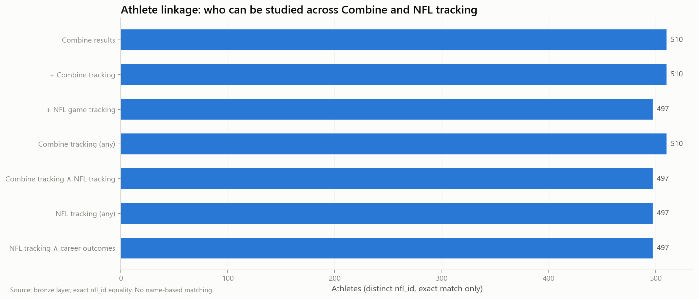
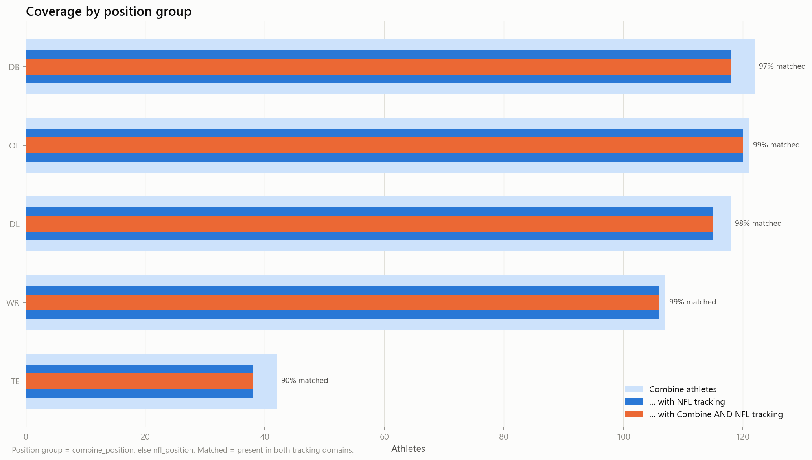
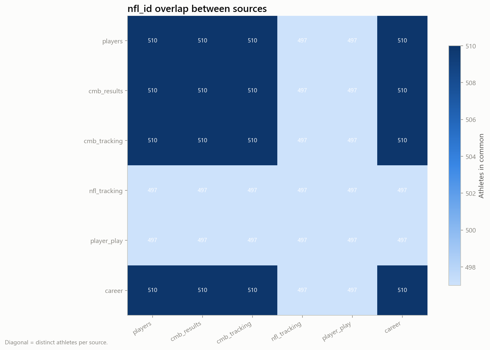

# 04 — Relationship analysis

_Step 4: entity relationships, athlete linkage and join cardinality_

_Generated 2026-10-08T00:36:07Z by `nflbdb.data` — numbers below come from executed code only._

## Athlete linkage summary

| item | value |
|---|---|
| Combine athletes (results ∪ tracking) | 510 |
| NFL tracked athletes | 497 |
| Matched (Combine tracking ∧ NFL tracking) | 497 |
| Combine athletes without NFL tracking | 13 |
| Identity ambiguities flagged | 0 |
| Linkage method | exact nfl_id equality only |

## Linkage funnel

| stage | n_athletes |
|---|---|
| Combine results | 510 |
| + Combine tracking | 510 |
| + NFL game tracking | 497 |
| Combine tracking (any) | 510 |
| Combine tracking ∧ NFL tracking | 497 |
| NFL tracking (any) | 497 |
| NFL tracking ∧ career outcomes | 497 |

## Coverage by position group

| position_group | n_combine_athletes | n_with_combine_tracking | n_with_nfl_tracking | n_matched_tracking_both | n_with_career_outcomes | median_nfl_plays_if_tracked | match_rate |
|---|---|---|---|---|---|---|---|
| DB | 122 | 122 | 118 | 118 | 122 | 434.5 | 0.967 |
| DL | 118 | 118 | 115 | 115 | 118 | 395 | 0.975 |
| OL | 121 | 121 | 120 | 120 | 121 | 507.5 | 0.992 |
| TE | 42 | 42 | 38 | 38 | 42 | 192.5 | 0.905 |
| WR | 107 | 107 | 106 | 106 | 107 | 277 | 0.991 |

## Coverage by cohort (draft year)

| cohort | n_combine_athletes | n_with_combine_tracking | n_with_nfl_tracking | n_matched_tracking_both | n_with_career_outcomes | median_nfl_plays_if_tracked | match_rate |
|---|---|---|---|---|---|---|---|
| 2,023 | 160 | 160 | 158 | 158 | 160 | 573.5 | 0.988 |
| 2,024 | 177 | 177 | 175 | 175 | 177 | 381 | 0.989 |
| 2,025 | 173 | 173 | 164 | 164 | 173 | 224 | 0.948 |

## Identifier namespace check

| source | n_ids | min_id | max_id | median_id |
|---|---|---|---|---|
| players | 510 | 55,867 | 59,278 | 5.729e+04 |
| combine_results | 510 | 55,867 | 59,278 | 5.729e+04 |
| combine_tracking | 510 | 55,867 | 59,278 | 5.729e+04 |
| game_tracking | 497 | 55,867 | 59,278 | 5.728e+04 |
| player_play | 497 | 55,867 | 59,278 | 5.728e+04 |
| player_career_successes | 510 | 55,867 | 59,278 | 5.729e+04 |

Overlapping value ranges and high intersection counts support (but do not prove) a shared nfl_id namespace. Disjoint ranges for a source would indicate a different namespace requiring a crosswalk.

## Identity ambiguity diagnostics

_No ambiguities detected._

## Join cardinality (estimated from per-key counts — no join materialised)

| left | right | keys | cardinality | n_left | n_right | est_inner_rows | multiplicative_factor | left_match_rate | explosion_flag | purpose |
|---|---|---|---|---|---|---|---|---|---|---|
| combine_results | players | nfl_id | 1:1 | 510 | 510 | 510 | 1 | 1 | False | Attach biography to traditional Combine results |
| combine_tracking | combine_results | nfl_id | N:1 | 431,094 | 510 | 4.311e+05 | 1 | 1 | False | Tracking frames ↔ traditional results |
| player_play | games | game_id | N:1 | 314,197 | 1,002 | 3.142e+05 | 1 | 1 | False | Play rows ↔ game metadata |
| game_tracking | player_play | game_id, play_id, nfl_id | N:1 | 22,654,290 | 314,197 | 22,473,432 | 0.992 | 0.992 | False | Frames ↔ player-play context |
| game_tracking | player_play | game_id, play_id | N:M | 22,654,290 | 314,197 | 82,427,686 | 3.639 | 0.9993 | True | ANTI-PATTERN: frames ↔ player_play on play only (every frame × every player) |
| game_tracking | players | nfl_id | N:1 | 22,654,290 | 510 | 22,654,290 | 1 | 1 | False | Frames ↔ biography |
| combine_tracking | game_tracking | nfl_id | N:M | 431,094 | 22,654,290 | 18,663,886,845 | 823.9 | 0.9714 | True | ANTI-PATTERN: Combine frames × NFL frames — aggregate both sides to athlete level first |

> [!IMPORTANT]
> Never join frame-level tables of the two domains directly. Aggregate Combine and NFL tracking to athlete level (gold marts) and join those compact tables on nfl_id.
