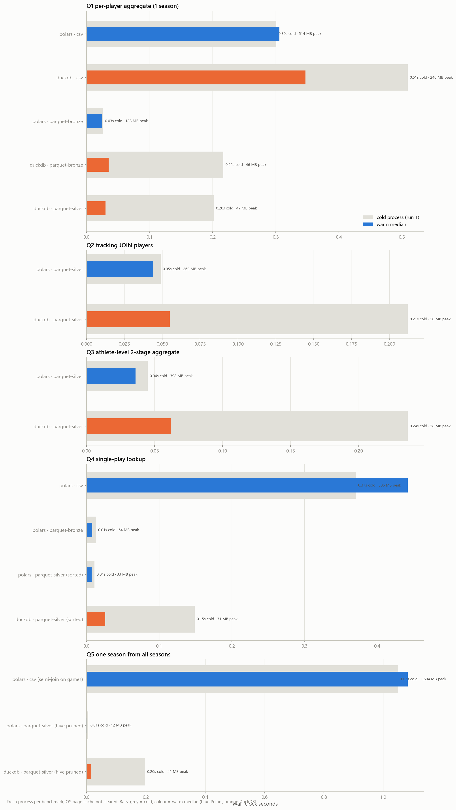

# 07 — Performance benchmarks

_Step 8: measured, identical-semantics comparisons_

_Generated 2026-10-08T00:31:13Z by `nflbdb.data` — numbers below come from executed code only._

## Method

- Each benchmark: fresh spawned process, 3 runs (run 1 = cold process, others = warm).
- OS file cache not cleared (Windows, no admin) → 'cold' means cold process, not cold disk. CSV runs first.
- Peak memory = max child RSS (20 ms sampling) minus RSS before the query.
- `results_identical` compares SHA-256 of normalised sorted results within each query group.
- Machine: 16 logical cores, 15.4 GB RAM, threads=15, DuckDB memory_limit=3GB.

## Results

| group | engine | format | cold_s | warm_median_s | peak_query_mb | rows_out | results_identical | ok | error |
|---|---|---|---|---|---|---|---|---|---|
| Q1 per-player aggregate (1 season) | polars | csv | 0.301 | 0.306 | 514.4 | 156 | True | True |  |
| Q1 per-player aggregate (1 season) | duckdb | csv | 0.509 | 0.347 | 239.8 | 156 | True | True |  |
| Q1 per-player aggregate (1 season) | polars | parquet-bronze | 0.026 | 0.025 | 188.2 | 156 | True | True |  |
| Q1 per-player aggregate (1 season) | duckdb | parquet-bronze | 0.217 | 0.035 | 46.2 | 156 | True | True |  |
| Q1 per-player aggregate (1 season) | duckdb | parquet-silver | 0.202 | 0.03 | 46.6 | 156 | True | True |  |
| Q2 tracking JOIN players | polars | parquet-silver | 0.049 | 0.044 | 269.2 | 12 | True | True |  |
| Q2 tracking JOIN players | duckdb | parquet-silver | 0.212 | 0.055 | 50.1 | 12 | True | True |  |
| Q3 athlete-level 2-stage aggregate | polars | parquet-silver | 0.045 | 0.036 | 397.9 | 156 | True | True |  |
| Q3 athlete-level 2-stage aggregate | duckdb | parquet-silver | 0.236 | 0.062 | 57.7 | 156 | True | True |  |
| Q4 single-play lookup | polars | csv | 0.371 | 0.442 | 506.3 | 62 | True | True |  |
| Q4 single-play lookup | polars | parquet-bronze | 0.013 | 0.008 | 63.5 | 62 | True | True |  |
| Q4 single-play lookup | polars | parquet-silver (sorted) | 0.011 | 0.007 | 32.7 | 62 | True | True |  |
| Q4 single-play lookup | duckdb | parquet-silver (sorted) | 0.149 | 0.026 | 31.2 | 62 | True | True |  |
| Q5 one season from all seasons | polars | csv (semi-join on games) | 1.05 | 1.082 | 1,604 | 1 | True | True |  |
| Q5 one season from all seasons | polars | parquet-silver (hive pruned) | 0.006 | 0.001 | 12 | 1 | True | True |  |
| Q5 one season from all seasons | duckdb | parquet-silver (hive pruned) | 0.197 | 0.016 | 41 | 1 | True | True |  |

## Storage footprint by layer

| layer | bytes | size | ratio_to_raw |
|---|---|---|---|
| raw (CSV) | 2,306,804,135 | 2.1 GB | 1 |
| bronze | 481,414,423 | 459.1 MB | 0.209 |
| silver | 584,784,522 | 557.7 MB | 0.254 |
| gold | 17,288,123 | 16.5 MB | 0.007 |

Interpretation must be grounded in the table above; a single query family is not evidence that one engine is universally faster.
