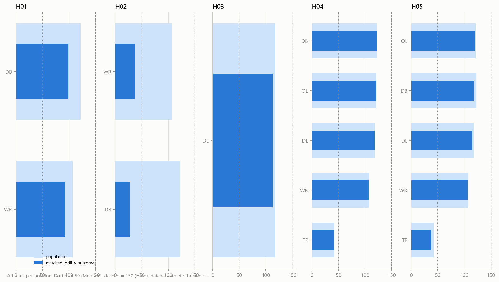

# 08 — Research feasibility

_Step 10: hypotheses vs. measured data coverage_

_Generated 2026-10-08T00:36:29Z by `nflbdb.data` — numbers below come from executed code only._

> [!NOTE]
> Counts are measured from gold tables. Confounders, biases, validation and interpretation are design assumptions to challenge, not findings. No model results are reported here.

## Feasibility matrix

| hypothesis | title | positions | n_population | n_traditional | n_combine_tracking_drill | n_outcome | n_matched | n_matched_with_baseline | largest_position | largest_position_n_matched | feasibility |
|---|---|---|---|---|---|---|---|---|---|---|---|
| H01 | Combine acceleration signature transfer | WR, DB, CB, S, RB | 229 | 201 | 196 | 224 | 192 | 192 | DB | 99 | Medium |
| H02 | Combine agility vs in-game change of direction | WR, DB, CB, S, LB | 229 | 77 | 68 | 224 | 65 | 62 | WR | 37 | Low |
| H03 | Defensive line explosiveness | DL, DE, DT, EDGE, IDL, NT | 118 | 109 | 117 | 114 | 113 | 104 | DL | 113 | Medium |
| H04 | Athletic outlier identification | all | 510 | 510 | 510 | 510 | 510 | 510 | DB | 122 | Medium |
| H05 | Position-specific movement profiles | all | 510 | 424 | 510 | 497 | 497 | 413 | OL | 120 | Medium |

### H01 — Combine acceleration signature transfer

- **Drill regex:** (?i)(40|DASH|SPRINT|SPLIT)
- **Matching drills:** FORTY_YARD_DASH, SHUFFLE_SPRINT_AND_COD_DRILL
- **Traditional baseline:** forty, ten_yd_split
- **Nfl outcome:** Context-adjusted in-game acceleration (play max_a / time-to-speed from frames)
- **Confounders:** Route/assignment mix, play context (down, distance), scheme, fatigue, injuries, age.
- **Selection bias:** Only drafted / rostered athletes appear in NFL tracking (survivorship); opportunity varies by depth chart.
- **Validation:** Grouped-by-athlete CV; cohort holdout (train 2023-24 cohorts, test 2025); compare vs 40/10-yd baseline.
- **Football interpretation:** Does the *shape* of acceleration (not the 40 time) carry over to how quickly a player reaches speed in games?
- **Limitations:** In-game acceleration is rarely maximal; needs event windows (e.g., snap → +2 s) in Phase 02.

### H02 — Combine agility vs in-game change of direction

- **Drill regex:** (?i)(CONE|SHUTTLE|AGILITY|L_DRILL|COD|TURN)
- **Matching drills:** SHORT_SHUTTLE, THREE_CONE_DRILL, OL_PULL_DRILL_FOLD_BLOCK_RIGHT, FOUR_BAG_AGILITY_DRILL, BODY_CONTROL_DRILL, OL_PULL_DRILL_DEEP_SHORT_PULL_LEFT, OL_PULL_DRILL_LONG_PULL_RIGHT, SHUFFLE_SPRINT_AND_COD_DRILL
- **Traditional baseline:** three_cone, short_shuttle
- **Nfl outcome:** Braking + re-acceleration around direction changes in game frames
- **Confounders:** Route tree / coverage assignment; defender leverage; game state.
- **Selection bias:** Many athletes skip agility drills (see participation heatmap) → non-random missingness.
- **Validation:** Athlete-grouped CV within position; sensitivity to direction-change threshold definitions.
- **Football interpretation:** Is Combine change-of-direction quality visible in route breaks / coverage transitions?
- **Limitations:** Requires robust heading-change detection on noisy tracking (smoothing study first).

### H03 — Defensive line explosiveness

- **Drill regex:** (?i)(DL|GET_OFF|BAG|EXPLOS|HOOP|RIP|SWIM)
- **Matching drills:** FOUR_BAG_AGILITY_DRILL, RUN_THE_HOOP_DRILL, BLOCK_EXPLOSION, FOUR_BAG_SHUFFLE_DRILL
- **Traditional baseline:** ten_yd_split, broad_jump, vertical
- **Nfl outcome:** player_get_off / time_to_pressure from player_play; first-step speed after snap from frames
- **Confounders:** Alignment (lined_up_position), stunts, double teams, pass vs run, down & distance.
- **Selection bias:** Get-off only defined on pass-rush snaps; rotational players have fewer snaps.
- **Validation:** Athlete-grouped CV; adjust for alignment; bootstrap CIs clustered by athlete.
- **Football interpretation:** Do Combine burst signatures predict how fast DL get off the ball in games?
- **Limitations:** Snap timing precision (10 Hz) bounds get-off resolution (~0.1 s).

### H04 — Athletic outlier identification

- **Drill regex:** .*
- **Matching drills:** FORTY_YARD_DASH, SHORT_SHUTTLE, THREE_CONE_DRILL, BOX_DRILL, BACK_PEDAL_AND_90_DEGREE_BREAK_TO_BALL, BACK_PEDAL_AND_TRANSITION_45_DEGREE_REACTION, W_DRILL, FIVE_YARD_WAVE_DRILL_SLIDE_AND_SHUFFLE
- **Traditional baseline:** ngs_athleticism_score, forty, broad_jump, vertical
- **Nfl outcome:** Career outcomes (snaps, starts) — targets only, with exposure-length adjustment
- **Confounders:** Draft capital (round/pick) strongly drives opportunity; team needs; injuries.
- **Selection bias:** Career length differs by cohort (2025 cohort has ≤1 season) → right-censoring.
- **Validation:** Within-cohort comparisons; control for draft pick; temporal holdout.
- **Football interpretation:** Which athletes move unusually well relative to their traditional scores, and does it matter?
- **Limitations:** Outcome = opportunity, not pure performance; requires censoring-aware analysis.

### H05 — Position-specific movement profiles

- **Drill regex:** .*
- **Matching drills:** FORTY_YARD_DASH, SHORT_SHUTTLE, THREE_CONE_DRILL, BOX_DRILL, BACK_PEDAL_AND_90_DEGREE_BREAK_TO_BALL, BACK_PEDAL_AND_TRANSITION_45_DEGREE_REACTION, W_DRILL, FIVE_YARD_WAVE_DRILL_SLIDE_AND_SHUFFLE
- **Traditional baseline:** forty
- **Nfl outcome:** Season movement distributions (mart_athlete_nfl_profile)
- **Confounders:** Role within position (slot vs outside WR, nickel vs boundary CB).
- **Selection bias:** Position labels differ between Combine and NFL (see dim_position crosswalk).
- **Validation:** Stability across seasons; split-half reliability of profiles.
- **Football interpretation:** Do transfer relationships differ by position (pooled vs position-aware models)?
- **Limitations:** Small positions (K/P/LS) are not analysable; group positions sensibly.

## Per-position detail

| position_group | n_population | n_traditional | n_combine_tracking_drill | n_outcome | n_matched | n_matched_with_baseline | hypothesis |
|---|---|---|---|---|---|---|---|
| DB | 122 | 104 | 102 | 118 | 99 | 99 | H01 |
| WR | 107 | 97 | 94 | 106 | 93 | 93 | H01 |
| WR | 107 | 44 | 38 | 106 | 37 | 34 | H02 |
| DB | 122 | 33 | 30 | 118 | 28 | 28 | H02 |
| DL | 118 | 109 | 117 | 114 | 113 | 104 | H03 |
| DB | 122 | 122 | 122 | 122 | 122 | 122 | H04 |
| OL | 121 | 121 | 121 | 121 | 121 | 121 | H04 |
| DL | 118 | 118 | 118 | 118 | 118 | 118 | H04 |
| WR | 107 | 107 | 107 | 107 | 107 | 107 | H04 |
| TE | 42 | 42 | 42 | 42 | 42 | 42 | H04 |
| OL | 121 | 95 | 121 | 120 | 120 | 94 | H05 |
| DB | 122 | 104 | 122 | 118 | 118 | 101 | H05 |
| DL | 118 | 94 | 118 | 115 | 115 | 91 | H05 |
| WR | 107 | 97 | 107 | 106 | 106 | 96 | H05 |
| TE | 42 | 34 | 42 | 38 | 38 | 31 | H05 |
