# Case-study gallery (executed)

_Generated 2026-10-14T13:20:58Z · run mode full. Cases are selected by pre-draft rules (notebook 09D); no NFL outcome value entered any selection._

## Same forty, different acceleration curve — Anthony Bradford vs Mason McCormick (OL)

*Matched on:* official forty within 0.03 s, 10-yard split within 0.03 s when recorded. *Contrast:* band acceleration, |z| of the difference (10.67).

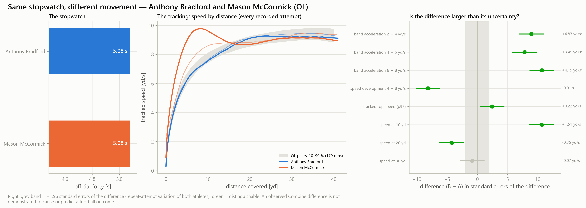

**Scout**
- *What is different:* Anthony Bradford and Mason McCormick (OL) ran official forty times of 5.08 s and 5.08 s — 0.00 s apart. Their official 10-yard splits are 1.74 s and 1.71 s. band acceleration 6 → 8 yd/s: 1.90 yd/s² versus 6.05 yd/s² — a difference of +4.15 yd/s² [+3.39, +4.91], larger than its measurement uncertainty. On this measure the observed value favours Mason McCormick. speed at 10 yd: 7.59 yd/s versus 9.10 yd/s — a difference of +1.51 yd/s [+1.23, +1.79], larger than its measurement uncertainty. On this measure the observed value favours Mason McCormick. speed development 4 → 8 yd/s: 1.59 s versus 0.68 s — a difference of -0.91 s [-1.13, -0.69], larger than its measurement uncertainty. On this measure the observed value favours Mason McCormick. 1 other feature(s) show a difference that is inside the measurement uncertainty and should not be read as a difference.
- *Is it measurable:* 5 of 8 tested curve features differ by more than the uncertainty of the difference (repeat-attempt variation of both athletes).
- *Film to examine:* Film — compare both prospects on screens and long pursuit after a turnover. Film — compare both prospects on the first steps of a pull or a set. Film — compare both prospects on pulls and climbs to the second level.
- *What remains uncertain:* Not separable on this evidence: speed at 30 yd. An observed Combine difference is not demonstrated to cause or predict a football outcome.

**Position coach**
- *Observed movement phase:* The measured difference sits in late acceleration and high speed (above about 6 yd/s). The measured difference sits in early acceleration (first steps, below about 4 yd/s). The measured difference sits in mid-sprint speed development (about 4 to 8 yd/s).
- *Relevant physical demand:* The NFL demand closest to late acceleration and high speed (above about 6 yd/s) ('transition_high') has too few tracked episodes for this position to be described. In tracked NFL games, OL athletes show 81 'accel_low' episodes per 100 eligible player-plays (67,409 episodes, 90 athletes): the physical demand closest to early acceleration (first steps, below about 4 yd/s). In tracked NFL games, OL athletes show 3 'accel_mid' episodes per 100 eligible player-plays (2,208 episodes, 83 athletes): the physical demand closest to mid-sprint speed development (about 4 to 8 yd/s).
- *Targeted movement testing:* Testing — a longer sprint or flying 20-yard segment, because 40 yards can end before top speed is reached. Testing — timed starts over 0–5 and 0–10 yd with split timing, at least two repetitions, recorded from before the first movement. Testing — rolling-start (flying) 10-yard segments entered at a controlled speed, so the 4 → 8 yd/s band is measured directly.
- *Measurement limitations:* A suggested test is a way to measure the phase again — its usefulness for football evaluation has not been established, and no training conclusion follows from an observed difference. One drill, at maximal effort, from rest, without pads: game movement depends on role, opportunity and context. Recording evidence is below the high tier for Mason McCormick: read the comparison with that in mind.

**General manager**
- *New information beyond official tests:* band acceleration 6 → 8 yd/s (moderately_repeatable_partly_beyond_stopwatch) speed at 10 yd (moderately_repeatable_partly_beyond_stopwatch) speed development 4 → 8 yd/s (repeatable_beyond_official) tracked top speed (p95) (repeatable_beyond_official)
- *Strength of evidence:* 5 distinguishable feature(s) out of 8 tested; recording evidence tiers: high and low.
- *Redundancy:* Largely the same information as official testing: speed at 20 yd.
- *Uncertainty:* Differences are tested against repeat-attempt variation only. NFL predictive value of any tracked Combine feature: not established.
- *Does this justify additional evaluation:* Yes — as a reason for additional film review or a targeted test of the named phase. It is not an input for ranking the two prospects.

## Same forty, different acceleration curve — Javon Bullard vs Jaylen Reed (DB)

*Matched on:* official forty within 0.03 s, 10-yard split within 0.03 s when recorded. *Contrast:* band acceleration, |z| of the difference (7.56).

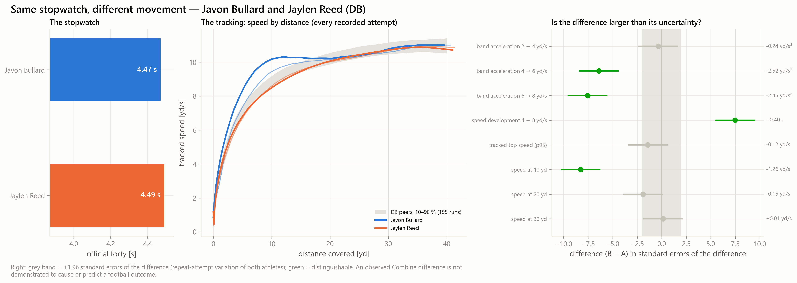

**Scout**
- *What is different:* Javon Bullard and Jaylen Reed (DB) ran official forty times of 4.47 s and 4.49 s — 0.02 s apart. Their official 10-yard splits are 1.51 s and 1.51 s. speed at 10 yd: 9.80 yd/s versus 8.54 yd/s — a difference of -1.26 yd/s [-1.56, -0.96], larger than its measurement uncertainty. On this measure the observed value favours Javon Bullard. band acceleration 6 → 8 yd/s: 5.71 yd/s² versus 3.26 yd/s² — a difference of -2.45 yd/s² [-3.08, -1.81], larger than its measurement uncertainty. On this measure the observed value favours Javon Bullard. speed development 4 → 8 yd/s: 0.64 s versus 1.04 s — a difference of +0.40 s [+0.30, +0.51], larger than its measurement uncertainty. On this measure the observed value favours Javon Bullard. 4 other feature(s) show a difference that is inside the measurement uncertainty and should not be read as a difference.
- *Is it measurable:* 3 of 8 tested curve features differ by more than the uncertainty of the difference (repeat-attempt variation of both athletes).
- *Film to examine:* Film — compare both prospects on the first steps out of the backpedal or stance when the play declares. Film — compare both prospects on carrying a vertical movement and long pursuit. Film — compare both prospects on closing from depth over 5 to 15 yards.
- *What remains uncertain:* Not separable on this evidence: band acceleration 2 → 4 yd/s, tracked top speed (p95), speed at 20 yd, speed at 30 yd. An observed Combine difference is not demonstrated to cause or predict a football outcome.

**Position coach**
- *Observed movement phase:* The measured difference sits in early acceleration (first steps, below about 4 yd/s). The measured difference sits in late acceleration and high speed (above about 6 yd/s). The measured difference sits in mid-sprint speed development (about 4 to 8 yd/s).
- *Relevant physical demand:* In tracked NFL games, DB athletes show 99 'accel_low' episodes per 100 eligible player-plays (63,068 episodes, 94 athletes): the physical demand closest to early acceleration (first steps, below about 4 yd/s). In tracked NFL games, DB athletes show 1 'transition_high' episodes per 100 eligible player-plays (565 episodes, 72 athletes): the physical demand closest to late acceleration and high speed (above about 6 yd/s). In tracked NFL games, DB athletes show 19 'accel_mid' episodes per 100 eligible player-plays (12,387 episodes, 94 athletes): the physical demand closest to mid-sprint speed development (about 4 to 8 yd/s).
- *Targeted movement testing:* Testing — timed starts over 0–5 and 0–10 yd with split timing, at least two repetitions, recorded from before the first movement. Testing — a longer sprint or flying 20-yard segment, because 40 yards can end before top speed is reached. Testing — rolling-start (flying) 10-yard segments entered at a controlled speed, so the 4 → 8 yd/s band is measured directly.
- *Measurement limitations:* A suggested test is a way to measure the phase again — its usefulness for football evaluation has not been established, and no training conclusion follows from an observed difference. One drill, at maximal effort, from rest, without pads: game movement depends on role, opportunity and context. Recording evidence is below the high tier for Javon Bullard, Jaylen Reed: read the comparison with that in mind.

**General manager**
- *New information beyond official tests:* speed at 10 yd (moderately_repeatable_partly_beyond_stopwatch) band acceleration 6 → 8 yd/s (moderately_repeatable_partly_beyond_stopwatch) speed development 4 → 8 yd/s (repeatable_beyond_official)
- *Strength of evidence:* 3 distinguishable feature(s) out of 8 tested; recording evidence tiers: low and low.
- *Redundancy:* No distinguishable feature of this pair is flagged as stopwatch-redundant.
- *Uncertainty:* Differences are tested against repeat-attempt variation only. NFL predictive value of any tracked Combine feature: not established.
- *Does this justify additional evaluation:* Yes — as a reason for additional film review or a targeted test of the named phase. It is not an input for ranking the two prospects.

## Same top speed, different speed development — Calen Bullock vs Jaylen Reed (DB)

*Matched on:* official forty within 0.03 s, tracked top speed within 0.05 yd/s. *Contrast:* speed development 4 → 8 yd/s, |z| of the difference (7.51).

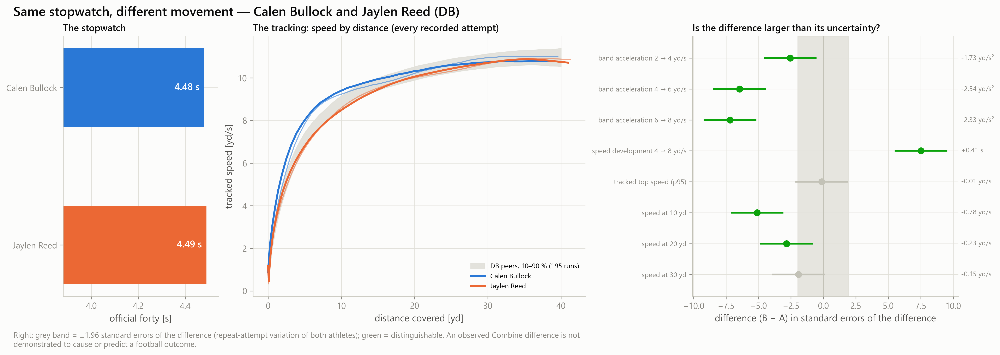

**Scout**
- *What is different:* Calen Bullock and Jaylen Reed (DB) ran official forty times of 4.48 s and 4.49 s — 0.01 s apart. Their official 10-yard splits are 1.51 s and 1.51 s. speed development 4 → 8 yd/s: 0.64 s versus 1.04 s — a difference of +0.41 s [+0.30, +0.51], larger than its measurement uncertainty. On this measure the observed value favours Calen Bullock. band acceleration 6 → 8 yd/s: 5.59 yd/s² versus 3.26 yd/s² — a difference of -2.33 yd/s² [-2.96, -1.69], larger than its measurement uncertainty. On this measure the observed value favours Calen Bullock. speed at 10 yd: 9.32 yd/s versus 8.54 yd/s — a difference of -0.78 yd/s [-1.08, -0.48], larger than its measurement uncertainty. On this measure the observed value favours Calen Bullock. 2 other feature(s) show a difference that is inside the measurement uncertainty and should not be read as a difference.
- *Is it measurable:* 4 of 8 tested curve features differ by more than the uncertainty of the difference (repeat-attempt variation of both athletes).
- *Film to examine:* Film — compare both prospects on closing from depth over 5 to 15 yards. Film — compare both prospects on carrying a vertical movement and long pursuit. Film — compare both prospects on the first steps out of the backpedal or stance when the play declares.
- *What remains uncertain:* Not separable on this evidence: tracked top speed (p95), speed at 30 yd. An observed Combine difference is not demonstrated to cause or predict a football outcome.

**Position coach**
- *Observed movement phase:* The measured difference sits in mid-sprint speed development (about 4 to 8 yd/s). The measured difference sits in late acceleration and high speed (above about 6 yd/s). The measured difference sits in early acceleration (first steps, below about 4 yd/s).
- *Relevant physical demand:* In tracked NFL games, DB athletes show 19 'accel_mid' episodes per 100 eligible player-plays (12,387 episodes, 94 athletes): the physical demand closest to mid-sprint speed development (about 4 to 8 yd/s). In tracked NFL games, DB athletes show 1 'transition_high' episodes per 100 eligible player-plays (565 episodes, 72 athletes): the physical demand closest to late acceleration and high speed (above about 6 yd/s). In tracked NFL games, DB athletes show 99 'accel_low' episodes per 100 eligible player-plays (63,068 episodes, 94 athletes): the physical demand closest to early acceleration (first steps, below about 4 yd/s).
- *Targeted movement testing:* Testing — rolling-start (flying) 10-yard segments entered at a controlled speed, so the 4 → 8 yd/s band is measured directly. Testing — a longer sprint or flying 20-yard segment, because 40 yards can end before top speed is reached. Testing — timed starts over 0–5 and 0–10 yd with split timing, at least two repetitions, recorded from before the first movement.
- *Measurement limitations:* A suggested test is a way to measure the phase again — its usefulness for football evaluation has not been established, and no training conclusion follows from an observed difference. One drill, at maximal effort, from rest, without pads: game movement depends on role, opportunity and context. Recording evidence is below the high tier for Calen Bullock, Jaylen Reed: read the comparison with that in mind.

**General manager**
- *New information beyond official tests:* speed development 4 → 8 yd/s (repeatable_beyond_official) band acceleration 6 → 8 yd/s (moderately_repeatable_partly_beyond_stopwatch) speed at 10 yd (moderately_repeatable_partly_beyond_stopwatch)
- *Strength of evidence:* 4 distinguishable feature(s) out of 8 tested; recording evidence tiers: low and low.
- *Redundancy:* Largely the same information as official testing: speed at 20 yd.
- *Uncertainty:* Differences are tested against repeat-attempt variation only. NFL predictive value of any tracked Combine feature: not established.
- *Does this justify additional evaluation:* Yes — as a reason for additional film review or a targeted test of the named phase. It is not an input for ranking the two prospects.

## Same top speed, different speed development — Javon Bullard vs Quincy Riley (DB)

*Matched on:* official forty within 0.03 s, tracked top speed within 0.05 yd/s. *Contrast:* speed development 4 → 8 yd/s, |z| of the difference (6.85).

**Scout**
- *What is different:* Javon Bullard and Quincy Riley (DB) ran official forty times of 4.47 s and 4.48 s — 0.01 s apart. Their official 10-yard splits are 1.51 s and 1.54 s. speed at 10 yd: 9.80 yd/s versus 8.60 yd/s — a difference of -1.21 yd/s [-1.51, -0.91], larger than its measurement uncertainty. On this measure the observed value favours Javon Bullard. band acceleration 6 → 8 yd/s: 5.71 yd/s² versus 3.42 yd/s² — a difference of -2.28 yd/s² [-2.92, -1.65], larger than its measurement uncertainty. On this measure the observed value favours Javon Bullard. speed development 4 → 8 yd/s: 0.64 s versus 1.01 s — a difference of +0.37 s [+0.26, +0.48], larger than its measurement uncertainty. On this measure the observed value favours Javon Bullard. 3 other feature(s) show a difference that is inside the measurement uncertainty and should not be read as a difference.
- *Is it measurable:* 4 of 8 tested curve features differ by more than the uncertainty of the difference (repeat-attempt variation of both athletes).
- *Film to examine:* Film — compare both prospects on the first steps out of the backpedal or stance when the play declares. Film — compare both prospects on carrying a vertical movement and long pursuit. Film — compare both prospects on closing from depth over 5 to 15 yards.
- *What remains uncertain:* Not separable on this evidence: band acceleration 2 → 4 yd/s, tracked top speed (p95), speed at 20 yd. An observed Combine difference is not demonstrated to cause or predict a football outcome.

**Position coach**
- *Observed movement phase:* The measured difference sits in early acceleration (first steps, below about 4 yd/s). The measured difference sits in late acceleration and high speed (above about 6 yd/s). The measured difference sits in mid-sprint speed development (about 4 to 8 yd/s).
- *Relevant physical demand:* In tracked NFL games, DB athletes show 99 'accel_low' episodes per 100 eligible player-plays (63,068 episodes, 94 athletes): the physical demand closest to early acceleration (first steps, below about 4 yd/s). In tracked NFL games, DB athletes show 1 'transition_high' episodes per 100 eligible player-plays (565 episodes, 72 athletes): the physical demand closest to late acceleration and high speed (above about 6 yd/s). In tracked NFL games, DB athletes show 19 'accel_mid' episodes per 100 eligible player-plays (12,387 episodes, 94 athletes): the physical demand closest to mid-sprint speed development (about 4 to 8 yd/s).
- *Targeted movement testing:* Testing — timed starts over 0–5 and 0–10 yd with split timing, at least two repetitions, recorded from before the first movement. Testing — a longer sprint or flying 20-yard segment, because 40 yards can end before top speed is reached. Testing — rolling-start (flying) 10-yard segments entered at a controlled speed, so the 4 → 8 yd/s band is measured directly.
- *Measurement limitations:* A suggested test is a way to measure the phase again — its usefulness for football evaluation has not been established, and no training conclusion follows from an observed difference. One drill, at maximal effort, from rest, without pads: game movement depends on role, opportunity and context. Recording evidence is below the high tier for Javon Bullard: read the comparison with that in mind.

**General manager**
- *New information beyond official tests:* speed at 10 yd (moderately_repeatable_partly_beyond_stopwatch) band acceleration 6 → 8 yd/s (moderately_repeatable_partly_beyond_stopwatch) speed development 4 → 8 yd/s (repeatable_beyond_official)
- *Strength of evidence:* 4 distinguishable feature(s) out of 8 tested; recording evidence tiers: low and high.
- *Redundancy:* Largely the same information as official testing: speed at 30 yd.
- *Uncertainty:* Differences are tested against repeat-attempt variation only. NFL predictive value of any tracked Combine feature: not established.
- *Does this justify additional evaluation:* Yes — as a reason for additional film review or a targeted test of the named phase. It is not an input for ranking the two prospects.

## Same first 10 yards, different later acceleration — Josh Newton vs Chau Smith-Wade (DB)

*Matched on:* official forty within 0.03 s, 10-yard split within 0.02 s, speed at 10 yd not distinguishable. *Contrast:* late-run feature, |z| of the difference (7.32).

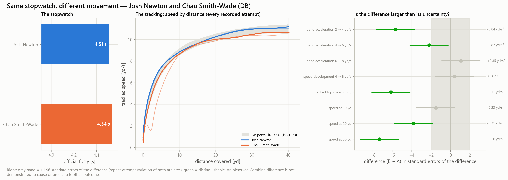

**Scout**
- *What is different:* Josh Newton and Chau Smith-Wade (DB) ran official forty times of 4.51 s and 4.54 s — 0.03 s apart. Their official 10-yard splits are 1.55 s and 1.55 s. speed at 30 yd: 10.98 yd/s versus 10.42 yd/s — a difference of -0.56 yd/s [-0.71, -0.41], larger than its measurement uncertainty. On this measure the observed value favours Josh Newton. tracked top speed (p95): 11.04 yd/s versus 10.53 yd/s — a difference of -0.51 yd/s [-0.68, -0.35], larger than its measurement uncertainty. On this measure the observed value favours Josh Newton. speed at 20 yd: 10.25 yd/s versus 9.94 yd/s — a difference of -0.31 yd/s [-0.47, -0.15], larger than its measurement uncertainty. On this measure the observed value favours Josh Newton. 3 other feature(s) show a difference that is inside the measurement uncertainty and should not be read as a difference.
- *Is it measurable:* 3 of 8 tested curve features differ by more than the uncertainty of the difference (repeat-attempt variation of both athletes).
- *Film to examine:* Film — compare both prospects on carrying a vertical movement and long pursuit. Film — compare both prospects on closing from depth over 5 to 15 yards.
- *What remains uncertain:* Not separable on this evidence: band acceleration 6 → 8 yd/s, speed development 4 → 8 yd/s, speed at 10 yd. An observed Combine difference is not demonstrated to cause or predict a football outcome.

**Position coach**
- *Observed movement phase:* The measured difference sits in late acceleration and high speed (above about 6 yd/s). The measured difference sits in mid-sprint speed development (about 4 to 8 yd/s).
- *Relevant physical demand:* In tracked NFL games, DB athletes show 1 'transition_high' episodes per 100 eligible player-plays (565 episodes, 72 athletes): the physical demand closest to late acceleration and high speed (above about 6 yd/s). In tracked NFL games, DB athletes show 19 'accel_mid' episodes per 100 eligible player-plays (12,387 episodes, 94 athletes): the physical demand closest to mid-sprint speed development (about 4 to 8 yd/s).
- *Targeted movement testing:* Testing — a longer sprint or flying 20-yard segment, because 40 yards can end before top speed is reached. Testing — rolling-start (flying) 10-yard segments entered at a controlled speed, so the 4 → 8 yd/s band is measured directly.
- *Measurement limitations:* A suggested test is a way to measure the phase again — its usefulness for football evaluation has not been established, and no training conclusion follows from an observed difference. One drill, at maximal effort, from rest, without pads: game movement depends on role, opportunity and context. Recording evidence is below the high tier for Chau Smith-Wade: read the comparison with that in mind.

**General manager**
- *New information beyond official tests:* tracked top speed (p95) (repeatable_beyond_official)
- *Strength of evidence:* 3 distinguishable feature(s) out of 8 tested; recording evidence tiers: high and medium.
- *Redundancy:* Largely the same information as official testing: speed at 30 yd, speed at 20 yd.
- *Uncertainty:* Differences are tested against repeat-attempt variation only. NFL predictive value of any tracked Combine feature: not established.
- *Does this justify additional evaluation:* Yes — as a reason for additional film review or a targeted test of the named phase. It is not an input for ranking the two prospects.

## Same first 10 yards, different later acceleration — Ladd McConkey vs Isaiah Bond (WR)

*Matched on:* official forty within 0.03 s, 10-yard split within 0.02 s, speed at 10 yd not distinguishable. *Contrast:* late-run feature, |z| of the difference (5.88).

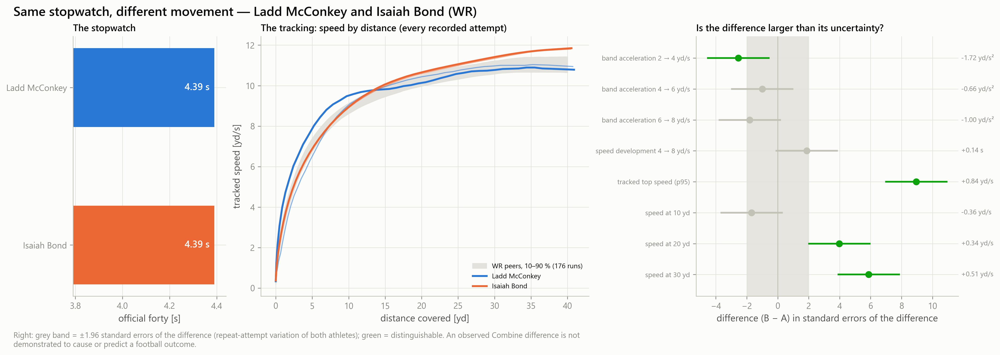

**Scout**
- *What is different:* Ladd McConkey and Isaiah Bond (WR) ran official forty times of 4.39 s and 4.39 s — 0.00 s apart. Their official 10-yard splits are 1.52 s and 1.51 s. tracked top speed (p95): 10.93 yd/s versus 11.76 yd/s — a difference of +0.84 yd/s [+0.65, +1.02], larger than its measurement uncertainty. On this measure the observed value favours Isaiah Bond. speed at 30 yd: 10.87 yd/s versus 11.38 yd/s — a difference of +0.51 yd/s [+0.34, +0.67], larger than its measurement uncertainty. On this measure the observed value favours Isaiah Bond. speed at 20 yd: 10.29 yd/s versus 10.62 yd/s — a difference of +0.34 yd/s [+0.17, +0.50], larger than its measurement uncertainty. On this measure the observed value favours Isaiah Bond. 4 other feature(s) show a difference that is inside the measurement uncertainty and should not be read as a difference.
- *Is it measurable:* 3 of 8 tested curve features differ by more than the uncertainty of the difference (repeat-attempt variation of both athletes).
- *Film to examine:* Film — compare both prospects on vertical movements and long runs after the catch. Film — compare both prospects on the stem of intermediate movements before the break.
- *What remains uncertain:* Not separable on this evidence: band acceleration 4 → 6 yd/s, band acceleration 6 → 8 yd/s, speed development 4 → 8 yd/s, speed at 10 yd. An observed Combine difference is not demonstrated to cause or predict a football outcome.

**Position coach**
- *Observed movement phase:* The measured difference sits in late acceleration and high speed (above about 6 yd/s). The measured difference sits in mid-sprint speed development (about 4 to 8 yd/s).
- *Relevant physical demand:* In tracked NFL games, WR athletes show 1 'transition_high' episodes per 100 eligible player-plays (545 episodes, 68 athletes): the physical demand closest to late acceleration and high speed (above about 6 yd/s). In tracked NFL games, WR athletes show 7 'accel_mid' episodes per 100 eligible player-plays (2,520 episodes, 80 athletes): the physical demand closest to mid-sprint speed development (about 4 to 8 yd/s).
- *Targeted movement testing:* Testing — a longer sprint or flying 20-yard segment, because 40 yards can end before top speed is reached. Testing — rolling-start (flying) 10-yard segments entered at a controlled speed, so the 4 → 8 yd/s band is measured directly.
- *Measurement limitations:* A suggested test is a way to measure the phase again — its usefulness for football evaluation has not been established, and no training conclusion follows from an observed difference. One drill, at maximal effort, from rest, without pads: game movement depends on role, opportunity and context. Recording evidence is below the high tier for Ladd McConkey: read the comparison with that in mind.

**General manager**
- *New information beyond official tests:* tracked top speed (p95) (repeatable_beyond_official)
- *Strength of evidence:* 3 distinguishable feature(s) out of 8 tested; recording evidence tiers: low and high.
- *Redundancy:* Largely the same information as official testing: speed at 30 yd, speed at 20 yd.
- *Uncertainty:* Differences are tested against repeat-attempt variation only. NFL predictive value of any tracked Combine feature: not established.
- *Does this justify additional evaluation:* Yes — as a reason for additional film review or a targeted test of the named phase. It is not an input for ranking the two prospects.

## Similar official tests, distant movement fingerprints — Jaylen Key vs Rayuan Lane (DB)

*Matched on:* official forty within 0.03 s, 10-yard split within 0.03 s, weight within 15 lb, height within 2 in. *Contrast:* TCN-B fingerprint distance (mathematical similarity) (1.39).

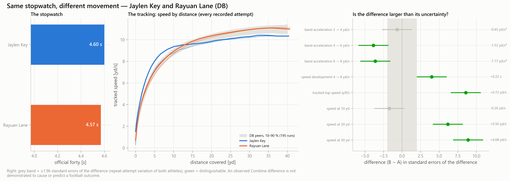

**Scout**
- *What is different:* Jaylen Key and Rayuan Lane (DB) ran official forty times of 4.60 s and 4.57 s — 0.03 s apart. Their official 10-yard splits are 1.59 s and 1.56 s. speed at 30 yd: 10.24 yd/s versus 10.92 yd/s — a difference of +0.68 yd/s [+0.53, +0.84], larger than its measurement uncertainty. On this measure the observed value favours Rayuan Lane. tracked top speed (p95): 10.36 yd/s versus 11.08 yd/s — a difference of +0.72 yd/s [+0.55, +0.88], larger than its measurement uncertainty. On this measure the observed value favours Rayuan Lane. speed at 20 yd: 9.80 yd/s versus 10.30 yd/s — a difference of +0.50 yd/s [+0.34, +0.66], larger than its measurement uncertainty. On this measure the observed value favours Rayuan Lane. 2 other feature(s) show a difference that is inside the measurement uncertainty and should not be read as a difference.
- *Is it measurable:* 5 of 8 tested curve features differ by more than the uncertainty of the difference (repeat-attempt variation of both athletes).
- *Film to examine:* Film — compare both prospects on carrying a vertical movement and long pursuit. Film — compare both prospects on closing from depth over 5 to 15 yards.
- *What remains uncertain:* Not separable on this evidence: band acceleration 2 → 4 yd/s, speed at 10 yd. An observed Combine difference is not demonstrated to cause or predict a football outcome.

**Position coach**
- *Observed movement phase:* The measured difference sits in late acceleration and high speed (above about 6 yd/s). The measured difference sits in mid-sprint speed development (about 4 to 8 yd/s).
- *Relevant physical demand:* In tracked NFL games, DB athletes show 1 'transition_high' episodes per 100 eligible player-plays (565 episodes, 72 athletes): the physical demand closest to late acceleration and high speed (above about 6 yd/s). In tracked NFL games, DB athletes show 19 'accel_mid' episodes per 100 eligible player-plays (12,387 episodes, 94 athletes): the physical demand closest to mid-sprint speed development (about 4 to 8 yd/s).
- *Targeted movement testing:* Testing — a longer sprint or flying 20-yard segment, because 40 yards can end before top speed is reached. Testing — rolling-start (flying) 10-yard segments entered at a controlled speed, so the 4 → 8 yd/s band is measured directly.
- *Measurement limitations:* A suggested test is a way to measure the phase again — its usefulness for football evaluation has not been established, and no training conclusion follows from an observed difference. One drill, at maximal effort, from rest, without pads: game movement depends on role, opportunity and context. Recording evidence is below the high tier for Jaylen Key: read the comparison with that in mind.

**General manager**
- *New information beyond official tests:* tracked top speed (p95) (repeatable_beyond_official) speed development 4 → 8 yd/s (repeatable_beyond_official) band acceleration 6 → 8 yd/s (moderately_repeatable_partly_beyond_stopwatch)
- *Strength of evidence:* 5 distinguishable feature(s) out of 8 tested; recording evidence tiers: medium and high.
- *Redundancy:* Largely the same information as official testing: speed at 30 yd, speed at 20 yd.
- *Uncertainty:* Differences are tested against repeat-attempt variation only. NFL predictive value of any tracked Combine feature: not established.
- *Does this justify additional evaluation:* Yes — as a reason for additional film review or a targeted test of the named phase. It is not an input for ranking the two prospects.

## Similar official tests, distant movement fingerprints — Cody Mauch vs Connor Colby (OL)

*Matched on:* official forty within 0.03 s, 10-yard split within 0.03 s, weight within 15 lb, height within 2 in. *Contrast:* TCN-B fingerprint distance (mathematical similarity) (1.16).

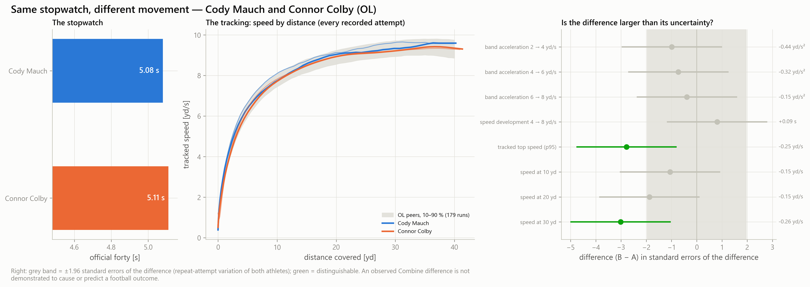

**Scout**
- *What is different:* Cody Mauch and Connor Colby (OL) ran official forty times of 5.08 s and 5.11 s — 0.03 s apart. Their official 10-yard splits are 1.79 s and 1.78 s. speed at 30 yd: 9.48 yd/s versus 9.22 yd/s — a difference of -0.26 yd/s [-0.43, -0.09], larger than its measurement uncertainty. On this measure the observed value favours Cody Mauch. tracked top speed (p95): 9.61 yd/s versus 9.36 yd/s — a difference of -0.25 yd/s [-0.43, -0.07], larger than its measurement uncertainty. On this measure the observed value favours Cody Mauch. 6 other feature(s) show a difference that is inside the measurement uncertainty and should not be read as a difference.
- *Is it measurable:* 2 of 8 tested curve features differ by more than the uncertainty of the difference (repeat-attempt variation of both athletes).
- *Film to examine:* Film — compare both prospects on screens and long pursuit after a turnover.
- *What remains uncertain:* Not separable on this evidence: band acceleration 2 → 4 yd/s, band acceleration 4 → 6 yd/s, band acceleration 6 → 8 yd/s, speed development 4 → 8 yd/s, speed at 10 yd. An observed Combine difference is not demonstrated to cause or predict a football outcome.

**Position coach**
- *Observed movement phase:* The measured difference sits in late acceleration and high speed (above about 6 yd/s).
- *Relevant physical demand:* The NFL demand closest to late acceleration and high speed (above about 6 yd/s) ('transition_high') has too few tracked episodes for this position to be described.
- *Targeted movement testing:* Testing — a longer sprint or flying 20-yard segment, because 40 yards can end before top speed is reached.
- *Measurement limitations:* A suggested test is a way to measure the phase again — its usefulness for football evaluation has not been established, and no training conclusion follows from an observed difference. One drill, at maximal effort, from rest, without pads: game movement depends on role, opportunity and context.

**General manager**
- *New information beyond official tests:* tracked top speed (p95) (repeatable_beyond_official)
- *Strength of evidence:* 2 distinguishable feature(s) out of 8 tested; recording evidence tiers: high and high.
- *Redundancy:* Largely the same information as official testing: speed at 30 yd.
- *Uncertainty:* Differences are tested against repeat-attempt variation only. NFL predictive value of any tracked Combine feature: not established.
- *Does this justify additional evaluation:* Yes — as a reason for additional film review or a targeted test of the named phase. It is not an input for ranking the two prospects.

## High-confidence movement difference — Isaiah Neyor vs Isaiah Bond (WR)

*Matched on:* official forty within 0.03 s, both recordings in the high evidence tier, ≥ 2 distinguishable features. *Contrast:* largest |z| of a difference (8.05).

**Scout**
- *What is different:* Isaiah Neyor and Isaiah Bond (WR) ran official forty times of 4.40 s and 4.39 s — 0.01 s apart. Their official 10-yard splits are 1.51 s and 1.51 s. tracked top speed (p95): 11.01 yd/s versus 11.76 yd/s — a difference of +0.75 yd/s [+0.57, +0.94], larger than its measurement uncertainty. On this measure the observed value favours Isaiah Bond. speed at 30 yd: 10.97 yd/s versus 11.38 yd/s — a difference of +0.41 yd/s [+0.24, +0.58], larger than its measurement uncertainty. On this measure the observed value favours Isaiah Bond. 6 other feature(s) show a difference that is inside the measurement uncertainty and should not be read as a difference.
- *Is it measurable:* 2 of 8 tested curve features differ by more than the uncertainty of the difference (repeat-attempt variation of both athletes).
- *Film to examine:* Film — compare both prospects on vertical movements and long runs after the catch.
- *What remains uncertain:* Not separable on this evidence: band acceleration 2 → 4 yd/s, band acceleration 4 → 6 yd/s, band acceleration 6 → 8 yd/s, speed development 4 → 8 yd/s, speed at 10 yd. An observed Combine difference is not demonstrated to cause or predict a football outcome.

**Position coach**
- *Observed movement phase:* The measured difference sits in late acceleration and high speed (above about 6 yd/s).
- *Relevant physical demand:* In tracked NFL games, WR athletes show 1 'transition_high' episodes per 100 eligible player-plays (545 episodes, 68 athletes): the physical demand closest to late acceleration and high speed (above about 6 yd/s).
- *Targeted movement testing:* Testing — a longer sprint or flying 20-yard segment, because 40 yards can end before top speed is reached.
- *Measurement limitations:* A suggested test is a way to measure the phase again — its usefulness for football evaluation has not been established, and no training conclusion follows from an observed difference. One drill, at maximal effort, from rest, without pads: game movement depends on role, opportunity and context.

**General manager**
- *New information beyond official tests:* tracked top speed (p95) (repeatable_beyond_official)
- *Strength of evidence:* 2 distinguishable feature(s) out of 8 tested; recording evidence tiers: high and high.
- *Redundancy:* Largely the same information as official testing: speed at 30 yd.
- *Uncertainty:* Differences are tested against repeat-attempt variation only. NFL predictive value of any tracked Combine feature: not established.
- *Does this justify additional evaluation:* Yes — as a reason for additional film review or a targeted test of the named phase. It is not an input for ranking the two prospects.

## High-confidence movement difference — Sydney Brown vs Alijah Clark (DB)

*Matched on:* official forty within 0.03 s, both recordings in the high evidence tier, ≥ 2 distinguishable features. *Contrast:* largest |z| of a difference (7.93).

**Scout**
- *What is different:* Sydney Brown and Alijah Clark (DB) ran official forty times of 4.47 s and 4.50 s — 0.03 s apart. Their official 10-yard splits are 1.51 s and 1.53 s. tracked top speed (p95): 11.36 yd/s versus 10.70 yd/s — a difference of -0.67 yd/s [-0.83, -0.50], larger than its measurement uncertainty. On this measure the observed value favours Sydney Brown. speed at 30 yd: 11.05 yd/s versus 10.57 yd/s — a difference of -0.47 yd/s [-0.63, -0.32], larger than its measurement uncertainty. On this measure the observed value favours Sydney Brown. speed at 20 yd: 10.32 yd/s versus 10.12 yd/s — a difference of -0.20 yd/s [-0.36, -0.04], larger than its measurement uncertainty. On this measure the observed value favours Sydney Brown. 5 other feature(s) show a difference that is inside the measurement uncertainty and should not be read as a difference.
- *Is it measurable:* 3 of 8 tested curve features differ by more than the uncertainty of the difference (repeat-attempt variation of both athletes).
- *Film to examine:* Film — compare both prospects on carrying a vertical movement and long pursuit. Film — compare both prospects on closing from depth over 5 to 15 yards.
- *What remains uncertain:* Not separable on this evidence: band acceleration 2 → 4 yd/s, band acceleration 4 → 6 yd/s, band acceleration 6 → 8 yd/s, speed development 4 → 8 yd/s, speed at 10 yd. An observed Combine difference is not demonstrated to cause or predict a football outcome.

**Position coach**
- *Observed movement phase:* The measured difference sits in late acceleration and high speed (above about 6 yd/s). The measured difference sits in mid-sprint speed development (about 4 to 8 yd/s).
- *Relevant physical demand:* In tracked NFL games, DB athletes show 1 'transition_high' episodes per 100 eligible player-plays (565 episodes, 72 athletes): the physical demand closest to late acceleration and high speed (above about 6 yd/s). In tracked NFL games, DB athletes show 19 'accel_mid' episodes per 100 eligible player-plays (12,387 episodes, 94 athletes): the physical demand closest to mid-sprint speed development (about 4 to 8 yd/s).
- *Targeted movement testing:* Testing — a longer sprint or flying 20-yard segment, because 40 yards can end before top speed is reached. Testing — rolling-start (flying) 10-yard segments entered at a controlled speed, so the 4 → 8 yd/s band is measured directly.
- *Measurement limitations:* A suggested test is a way to measure the phase again — its usefulness for football evaluation has not been established, and no training conclusion follows from an observed difference. One drill, at maximal effort, from rest, without pads: game movement depends on role, opportunity and context.

**General manager**
- *New information beyond official tests:* tracked top speed (p95) (repeatable_beyond_official)
- *Strength of evidence:* 3 distinguishable feature(s) out of 8 tested; recording evidence tiers: high and high.
- *Redundancy:* Largely the same information as official testing: speed at 30 yd, speed at 20 yd.
- *Uncertainty:* Differences are tested against repeat-attempt variation only. NFL predictive value of any tracked Combine feature: not established.
- *Does this justify additional evaluation:* Yes — as a reason for additional film review or a targeted test of the named phase. It is not an input for ranking the two prospects.

## Apparent difference inside the measurement uncertainty — Trevor Keegan vs Beaux Limmer (OL)

*Matched on:* official forty within 0.03 s. *Contrast:* largest speed-development difference that is NOT distinguishable (0.25).

**Scout**
- *What is different:* Trevor Keegan and Beaux Limmer (OL) ran official forty times of 5.24 s and 5.22 s — 0.02 s apart. Their official 10-yard splits are 1.78 s and 1.75 s. speed at 10 yd: 7.39 yd/s versus 7.82 yd/s — a difference of +0.42 yd/s [+0.08, +0.76], larger than its measurement uncertainty. On this measure the observed value favours Beaux Limmer. speed at 20 yd: 8.58 yd/s versus 8.80 yd/s — a difference of +0.22 yd/s [+0.02, +0.41], larger than its measurement uncertainty. On this measure the observed value favours Beaux Limmer. 4 other feature(s) show a difference that is inside the measurement uncertainty and should not be read as a difference.
- *Is it measurable:* 2 of 8 tested curve features differ by more than the uncertainty of the difference (repeat-attempt variation of both athletes).
- *Film to examine:* Film — compare both prospects on the first steps of a pull or a set. Film — compare both prospects on pulls and climbs to the second level.
- *What remains uncertain:* Not separable on this evidence: band acceleration 6 → 8 yd/s, speed development 4 → 8 yd/s, tracked top speed (p95), speed at 30 yd. An observed Combine difference is not demonstrated to cause or predict a football outcome.

**Position coach**
- *Observed movement phase:* The measured difference sits in early acceleration (first steps, below about 4 yd/s). The measured difference sits in mid-sprint speed development (about 4 to 8 yd/s).
- *Relevant physical demand:* In tracked NFL games, OL athletes show 81 'accel_low' episodes per 100 eligible player-plays (67,409 episodes, 90 athletes): the physical demand closest to early acceleration (first steps, below about 4 yd/s). In tracked NFL games, OL athletes show 3 'accel_mid' episodes per 100 eligible player-plays (2,208 episodes, 83 athletes): the physical demand closest to mid-sprint speed development (about 4 to 8 yd/s).
- *Targeted movement testing:* Testing — timed starts over 0–5 and 0–10 yd with split timing, at least two repetitions, recorded from before the first movement. Testing — rolling-start (flying) 10-yard segments entered at a controlled speed, so the 4 → 8 yd/s band is measured directly.
- *Measurement limitations:* A suggested test is a way to measure the phase again — its usefulness for football evaluation has not been established, and no training conclusion follows from an observed difference. One drill, at maximal effort, from rest, without pads: game movement depends on role, opportunity and context. Recording evidence is below the high tier for Trevor Keegan, Beaux Limmer: read the comparison with that in mind.

**General manager**
- *New information beyond official tests:* speed at 10 yd (moderately_repeatable_partly_beyond_stopwatch)
- *Strength of evidence:* 2 distinguishable feature(s) out of 8 tested; recording evidence tiers: medium and medium.
- *Redundancy:* Largely the same information as official testing: speed at 20 yd.
- *Uncertainty:* Differences are tested against repeat-attempt variation only. NFL predictive value of any tracked Combine feature: not established.
- *Does this justify additional evaluation:* Yes — as a reason for additional film review or a targeted test of the named phase. It is not an input for ranking the two prospects.

## Apparent difference inside the measurement uncertainty — Roger Rosengarten vs Frank Crum (OL)

*Matched on:* official forty within 0.03 s. *Contrast:* largest speed-development difference that is NOT distinguishable (0.23).

**Scout**
- *What is different:* Roger Rosengarten and Frank Crum (OL) ran official forty times of 4.92 s and 4.94 s — 0.02 s apart. Their official 10-yard splits are 1.73 s and 1.69 s. No tracked curve feature separates them beyond its measurement uncertainty: on the recorded evidence the two runs are not distinguishable.
- *Is it measurable:* 0 of 8 tested curve features differ by more than the uncertainty of the difference (repeat-attempt variation of both athletes).
- *Film to examine:* No specific film prompt from tracking.
- *What remains uncertain:* Not separable on this evidence: band acceleration 2 → 4 yd/s, band acceleration 4 → 6 yd/s, band acceleration 6 → 8 yd/s, speed development 4 → 8 yd/s, tracked top speed (p95). An observed Combine difference is not demonstrated to cause or predict a football outcome.

**Position coach**
- *Observed movement phase:* No movement phase is separated beyond measurement uncertainty.
- *Relevant physical demand:* No NFL demand profile is attached to this comparison.
- *Targeted movement testing:* None indicated by tracking.
- *Measurement limitations:* A suggested test is a way to measure the phase again — its usefulness for football evaluation has not been established, and no training conclusion follows from an observed difference. One drill, at maximal effort, from rest, without pads: game movement depends on role, opportunity and context. Recording evidence is below the high tier for Roger Rosengarten: read the comparison with that in mind.

**General manager**
- *New information beyond official tests:* None that is both distinguishable and not already carried by the stopwatch.
- *Strength of evidence:* 0 distinguishable feature(s) out of 8 tested; recording evidence tiers: medium and high.
- *Redundancy:* No distinguishable feature of this pair is flagged as stopwatch-redundant.
- *Uncertainty:* Differences are tested against repeat-attempt variation only. NFL predictive value of any tracked Combine feature: not established.
- *Does this justify additional evaluation:* No — tracking adds nothing here that justifies additional evaluation beyond official testing and film.

## Position-specific comparison — Jaylen Key vs Rayuan Lane (DB)

*Matched on:* official forty within 0.03 s; the top-ranked twin pair of each position not already a case. *Contrast:* largest |z| of a difference within the position (8.89).

**Scout**
- *What is different:* Jaylen Key and Rayuan Lane (DB) ran official forty times of 4.60 s and 4.57 s — 0.03 s apart. Their official 10-yard splits are 1.59 s and 1.56 s. speed at 30 yd: 10.24 yd/s versus 10.92 yd/s — a difference of +0.68 yd/s [+0.53, +0.84], larger than its measurement uncertainty. On this measure the observed value favours Rayuan Lane. tracked top speed (p95): 10.36 yd/s versus 11.08 yd/s — a difference of +0.72 yd/s [+0.55, +0.88], larger than its measurement uncertainty. On this measure the observed value favours Rayuan Lane. speed at 20 yd: 9.80 yd/s versus 10.30 yd/s — a difference of +0.50 yd/s [+0.34, +0.66], larger than its measurement uncertainty. On this measure the observed value favours Rayuan Lane. 2 other feature(s) show a difference that is inside the measurement uncertainty and should not be read as a difference.
- *Is it measurable:* 5 of 8 tested curve features differ by more than the uncertainty of the difference (repeat-attempt variation of both athletes).
- *Film to examine:* Film — compare both prospects on carrying a vertical movement and long pursuit. Film — compare both prospects on closing from depth over 5 to 15 yards.
- *What remains uncertain:* Not separable on this evidence: band acceleration 2 → 4 yd/s, speed at 10 yd. An observed Combine difference is not demonstrated to cause or predict a football outcome.

**Position coach**
- *Observed movement phase:* The measured difference sits in late acceleration and high speed (above about 6 yd/s). The measured difference sits in mid-sprint speed development (about 4 to 8 yd/s).
- *Relevant physical demand:* In tracked NFL games, DB athletes show 1 'transition_high' episodes per 100 eligible player-plays (565 episodes, 72 athletes): the physical demand closest to late acceleration and high speed (above about 6 yd/s). In tracked NFL games, DB athletes show 19 'accel_mid' episodes per 100 eligible player-plays (12,387 episodes, 94 athletes): the physical demand closest to mid-sprint speed development (about 4 to 8 yd/s).
- *Targeted movement testing:* Testing — a longer sprint or flying 20-yard segment, because 40 yards can end before top speed is reached. Testing — rolling-start (flying) 10-yard segments entered at a controlled speed, so the 4 → 8 yd/s band is measured directly.
- *Measurement limitations:* A suggested test is a way to measure the phase again — its usefulness for football evaluation has not been established, and no training conclusion follows from an observed difference. One drill, at maximal effort, from rest, without pads: game movement depends on role, opportunity and context. Recording evidence is below the high tier for Jaylen Key: read the comparison with that in mind.

**General manager**
- *New information beyond official tests:* tracked top speed (p95) (repeatable_beyond_official) speed development 4 → 8 yd/s (repeatable_beyond_official) band acceleration 6 → 8 yd/s (moderately_repeatable_partly_beyond_stopwatch)
- *Strength of evidence:* 5 distinguishable feature(s) out of 8 tested; recording evidence tiers: medium and high.
- *Redundancy:* Largely the same information as official testing: speed at 30 yd, speed at 20 yd.
- *Uncertainty:* Differences are tested against repeat-attempt variation only. NFL predictive value of any tracked Combine feature: not established.
- *Does this justify additional evaluation:* Yes — as a reason for additional film review or a targeted test of the named phase. It is not an input for ranking the two prospects.

## Position-specific comparison — Nesta Jade Silvera vs Justin Eboigbe (DL)

*Matched on:* official forty within 0.03 s; the top-ranked twin pair of each position not already a case. *Contrast:* largest |z| of a difference within the position (7.73).

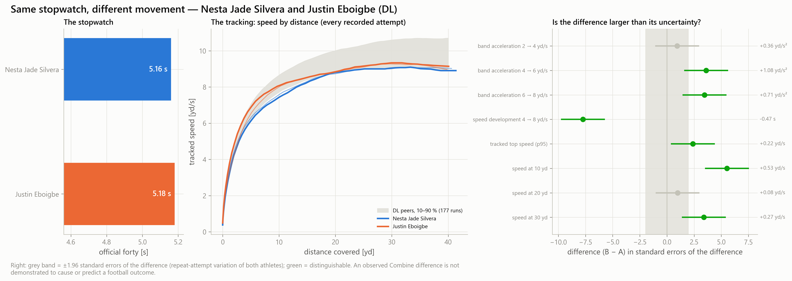

**Scout**
- *What is different:* Nesta Jade Silvera and Justin Eboigbe (DL) ran official forty times of 5.16 s and 5.18 s — 0.02 s apart. Their official 10-yard splits are 1.77 s and 1.80 s. speed development 4 → 8 yd/s: 1.72 s versus 1.25 s — a difference of -0.47 s [-0.59, -0.35], larger than its measurement uncertainty. On this measure the observed value favours Justin Eboigbe. speed at 10 yd: 7.50 yd/s versus 8.04 yd/s — a difference of +0.53 yd/s [+0.34, +0.72], larger than its measurement uncertainty. On this measure the observed value favours Justin Eboigbe. band acceleration 6 → 8 yd/s: 1.69 yd/s² versus 2.40 yd/s² — a difference of +0.71 yd/s² [+0.31, +1.11], larger than its measurement uncertainty. On this measure the observed value favours Justin Eboigbe. 2 other feature(s) show a difference that is inside the measurement uncertainty and should not be read as a difference.
- *Is it measurable:* 5 of 8 tested curve features differ by more than the uncertainty of the difference (repeat-attempt variation of both athletes).
- *Film to examine:* Film — compare both prospects on closing on the quarterback once free. Film — compare both prospects on the first two steps after the snap. Film — compare both prospects on backside pursuit over distance.
- *What remains uncertain:* Not separable on this evidence: band acceleration 2 → 4 yd/s, speed at 20 yd. An observed Combine difference is not demonstrated to cause or predict a football outcome.

**Position coach**
- *Observed movement phase:* The measured difference sits in mid-sprint speed development (about 4 to 8 yd/s). The measured difference sits in early acceleration (first steps, below about 4 yd/s). The measured difference sits in late acceleration and high speed (above about 6 yd/s).
- *Relevant physical demand:* In tracked NFL games, DL athletes show 10 'accel_mid' episodes per 100 eligible player-plays (4,789 episodes, 97 athletes): the physical demand closest to mid-sprint speed development (about 4 to 8 yd/s). In tracked NFL games, DL athletes show 107 'accel_low' episodes per 100 eligible player-plays (53,753 episodes, 98 athletes): the physical demand closest to early acceleration (first steps, below about 4 yd/s). In tracked NFL games, DL athletes show 0 'transition_high' episodes per 100 eligible player-plays (37 episodes, 22 athletes): the physical demand closest to late acceleration and high speed (above about 6 yd/s).
- *Targeted movement testing:* Testing — rolling-start (flying) 10-yard segments entered at a controlled speed, so the 4 → 8 yd/s band is measured directly. Testing — timed starts over 0–5 and 0–10 yd with split timing, at least two repetitions, recorded from before the first movement. Testing — a longer sprint or flying 20-yard segment, because 40 yards can end before top speed is reached.
- *Measurement limitations:* A suggested test is a way to measure the phase again — its usefulness for football evaluation has not been established, and no training conclusion follows from an observed difference. One drill, at maximal effort, from rest, without pads: game movement depends on role, opportunity and context.

**General manager**
- *New information beyond official tests:* speed development 4 → 8 yd/s (repeatable_beyond_official) speed at 10 yd (moderately_repeatable_partly_beyond_stopwatch) band acceleration 6 → 8 yd/s (moderately_repeatable_partly_beyond_stopwatch) tracked top speed (p95) (repeatable_beyond_official)
- *Strength of evidence:* 5 distinguishable feature(s) out of 8 tested; recording evidence tiers: high and high.
- *Redundancy:* Largely the same information as official testing: speed at 30 yd.
- *Uncertainty:* Differences are tested against repeat-attempt variation only. NFL predictive value of any tracked Combine feature: not established.
- *Does this justify additional evaluation:* Yes — as a reason for additional film review or a targeted test of the named phase. It is not an input for ranking the two prospects.

## Position-specific comparison — Mason McCormick vs Connor Colby (OL)

*Matched on:* official forty within 0.03 s; the top-ranked twin pair of each position not already a case. *Contrast:* largest |z| of a difference within the position (10.20).

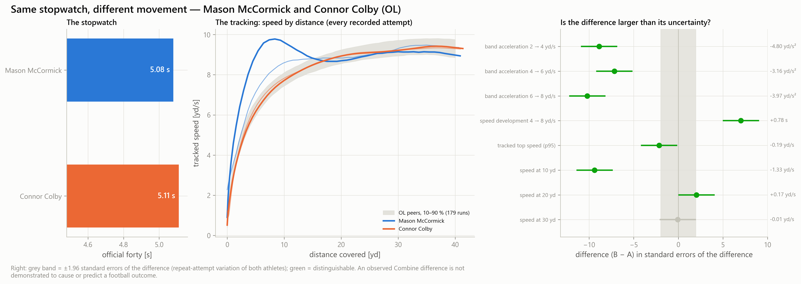

**Scout**
- *What is different:* Mason McCormick and Connor Colby (OL) ran official forty times of 5.08 s and 5.11 s — 0.03 s apart. Their official 10-yard splits are 1.71 s and 1.78 s. band acceleration 6 → 8 yd/s: 6.05 yd/s² versus 2.08 yd/s² — a difference of -3.97 yd/s² [-4.73, -3.21], larger than its measurement uncertainty. On this measure the observed value favours Mason McCormick. speed at 10 yd: 9.10 yd/s versus 7.77 yd/s — a difference of -1.33 yd/s [-1.61, -1.05], larger than its measurement uncertainty. On this measure the observed value favours Mason McCormick. speed development 4 → 8 yd/s: 0.68 s versus 1.46 s — a difference of +0.78 s [+0.56, +1.00], larger than its measurement uncertainty. On this measure the observed value favours Mason McCormick. 1 other feature(s) show a difference that is inside the measurement uncertainty and should not be read as a difference.
- *Is it measurable:* 5 of 8 tested curve features differ by more than the uncertainty of the difference (repeat-attempt variation of both athletes).
- *Film to examine:* Film — compare both prospects on screens and long pursuit after a turnover. Film — compare both prospects on the first steps of a pull or a set. Film — compare both prospects on pulls and climbs to the second level.
- *What remains uncertain:* Not separable on this evidence: speed at 30 yd. An observed Combine difference is not demonstrated to cause or predict a football outcome.

**Position coach**
- *Observed movement phase:* The measured difference sits in late acceleration and high speed (above about 6 yd/s). The measured difference sits in early acceleration (first steps, below about 4 yd/s). The measured difference sits in mid-sprint speed development (about 4 to 8 yd/s).
- *Relevant physical demand:* The NFL demand closest to late acceleration and high speed (above about 6 yd/s) ('transition_high') has too few tracked episodes for this position to be described. In tracked NFL games, OL athletes show 81 'accel_low' episodes per 100 eligible player-plays (67,409 episodes, 90 athletes): the physical demand closest to early acceleration (first steps, below about 4 yd/s). In tracked NFL games, OL athletes show 3 'accel_mid' episodes per 100 eligible player-plays (2,208 episodes, 83 athletes): the physical demand closest to mid-sprint speed development (about 4 to 8 yd/s).
- *Targeted movement testing:* Testing — a longer sprint or flying 20-yard segment, because 40 yards can end before top speed is reached. Testing — timed starts over 0–5 and 0–10 yd with split timing, at least two repetitions, recorded from before the first movement. Testing — rolling-start (flying) 10-yard segments entered at a controlled speed, so the 4 → 8 yd/s band is measured directly.
- *Measurement limitations:* A suggested test is a way to measure the phase again — its usefulness for football evaluation has not been established, and no training conclusion follows from an observed difference. One drill, at maximal effort, from rest, without pads: game movement depends on role, opportunity and context. Recording evidence is below the high tier for Mason McCormick: read the comparison with that in mind.

**General manager**
- *New information beyond official tests:* band acceleration 6 → 8 yd/s (moderately_repeatable_partly_beyond_stopwatch) speed at 10 yd (moderately_repeatable_partly_beyond_stopwatch) speed development 4 → 8 yd/s (repeatable_beyond_official) tracked top speed (p95) (repeatable_beyond_official)
- *Strength of evidence:* 5 distinguishable feature(s) out of 8 tested; recording evidence tiers: low and high.
- *Redundancy:* Largely the same information as official testing: speed at 20 yd.
- *Uncertainty:* Differences are tested against repeat-attempt variation only. NFL predictive value of any tracked Combine feature: not established.
- *Does this justify additional evaluation:* Yes — as a reason for additional film review or a targeted test of the named phase. It is not an input for ranking the two prospects.

## Position-specific comparison — Michael Mayer vs Ben Sinnott (TE)

*Matched on:* official forty within 0.03 s; the top-ranked twin pair of each position not already a case. *Contrast:* largest |z| of a difference within the position (6.69).

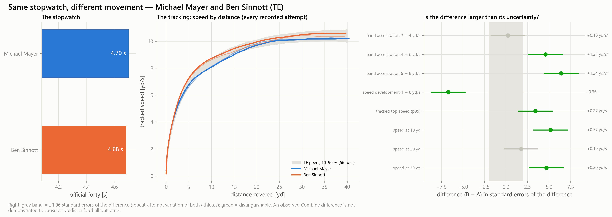

**Scout**
- *What is different:* Michael Mayer and Ben Sinnott (TE) ran official forty times of 4.70 s and 4.68 s — 0.02 s apart. Their official 10-yard splits are 1.66 s and 1.59 s. speed development 4 → 8 yd/s: 1.24 s versus 0.88 s — a difference of -0.36 s [-0.46, -0.25], larger than its measurement uncertainty. On this measure the observed value favours Ben Sinnott. band acceleration 6 → 8 yd/s: 2.49 yd/s² versus 3.73 yd/s² — a difference of +1.24 yd/s² [+0.86, +1.62], larger than its measurement uncertainty. On this measure the observed value favours Ben Sinnott. speed at 10 yd: 8.10 yd/s versus 8.67 yd/s — a difference of +0.57 yd/s [+0.35, +0.78], larger than its measurement uncertainty. On this measure the observed value favours Ben Sinnott. 2 other feature(s) show a difference that is inside the measurement uncertainty and should not be read as a difference.
- *Is it measurable:* 5 of 8 tested curve features differ by more than the uncertainty of the difference (repeat-attempt variation of both athletes).
- *Film to examine:* Film — compare both prospects on movements up the seam through the second level. Film — compare both prospects on long runs after the catch and vertical movements. Film — compare both prospects on releases from an in-line or attached alignment.
- *What remains uncertain:* Not separable on this evidence: band acceleration 2 → 4 yd/s, speed at 20 yd. An observed Combine difference is not demonstrated to cause or predict a football outcome.

**Position coach**
- *Observed movement phase:* The measured difference sits in mid-sprint speed development (about 4 to 8 yd/s). The measured difference sits in late acceleration and high speed (above about 6 yd/s). The measured difference sits in early acceleration (first steps, below about 4 yd/s).
- *Relevant physical demand:* In tracked NFL games, TE athletes show 12 'accel_mid' episodes per 100 eligible player-plays (971 episodes, 30 athletes): the physical demand closest to mid-sprint speed development (about 4 to 8 yd/s). In tracked NFL games, TE athletes show 1 'transition_high' episodes per 100 eligible player-plays (48 episodes, 17 athletes): the physical demand closest to late acceleration and high speed (above about 6 yd/s). In tracked NFL games, TE athletes show 102 'accel_low' episodes per 100 eligible player-plays (8,318 episodes, 33 athletes): the physical demand closest to early acceleration (first steps, below about 4 yd/s).
- *Targeted movement testing:* Testing — rolling-start (flying) 10-yard segments entered at a controlled speed, so the 4 → 8 yd/s band is measured directly. Testing — a longer sprint or flying 20-yard segment, because 40 yards can end before top speed is reached. Testing — timed starts over 0–5 and 0–10 yd with split timing, at least two repetitions, recorded from before the first movement.
- *Measurement limitations:* A suggested test is a way to measure the phase again — its usefulness for football evaluation has not been established, and no training conclusion follows from an observed difference. One drill, at maximal effort, from rest, without pads: game movement depends on role, opportunity and context.

**General manager**
- *New information beyond official tests:* speed development 4 → 8 yd/s (repeatable_beyond_official) band acceleration 6 → 8 yd/s (moderately_repeatable_partly_beyond_stopwatch) speed at 10 yd (moderately_repeatable_partly_beyond_stopwatch) tracked top speed (p95) (repeatable_beyond_official)
- *Strength of evidence:* 5 distinguishable feature(s) out of 8 tested; recording evidence tiers: high and high.
- *Redundancy:* Largely the same information as official testing: speed at 30 yd.
- *Uncertainty:* Differences are tested against repeat-attempt variation only. NFL predictive value of any tracked Combine feature: not established.
- *Does this justify additional evaluation:* Yes — as a reason for additional film review or a targeted test of the named phase. It is not an input for ranking the two prospects.

## Position-specific comparison — Ladd McConkey vs Isaiah Bond (WR)

*Matched on:* official forty within 0.03 s; the top-ranked twin pair of each position not already a case. *Contrast:* largest |z| of a difference within the position (8.95).

**Scout**
- *What is different:* Ladd McConkey and Isaiah Bond (WR) ran official forty times of 4.39 s and 4.39 s — 0.00 s apart. Their official 10-yard splits are 1.52 s and 1.51 s. tracked top speed (p95): 10.93 yd/s versus 11.76 yd/s — a difference of +0.84 yd/s [+0.65, +1.02], larger than its measurement uncertainty. On this measure the observed value favours Isaiah Bond. speed at 30 yd: 10.87 yd/s versus 11.38 yd/s — a difference of +0.51 yd/s [+0.34, +0.67], larger than its measurement uncertainty. On this measure the observed value favours Isaiah Bond. speed at 20 yd: 10.29 yd/s versus 10.62 yd/s — a difference of +0.34 yd/s [+0.17, +0.50], larger than its measurement uncertainty. On this measure the observed value favours Isaiah Bond. 4 other feature(s) show a difference that is inside the measurement uncertainty and should not be read as a difference.
- *Is it measurable:* 3 of 8 tested curve features differ by more than the uncertainty of the difference (repeat-attempt variation of both athletes).
- *Film to examine:* Film — compare both prospects on vertical movements and long runs after the catch. Film — compare both prospects on the stem of intermediate movements before the break.
- *What remains uncertain:* Not separable on this evidence: band acceleration 4 → 6 yd/s, band acceleration 6 → 8 yd/s, speed development 4 → 8 yd/s, speed at 10 yd. An observed Combine difference is not demonstrated to cause or predict a football outcome.

**Position coach**
- *Observed movement phase:* The measured difference sits in late acceleration and high speed (above about 6 yd/s). The measured difference sits in mid-sprint speed development (about 4 to 8 yd/s).
- *Relevant physical demand:* In tracked NFL games, WR athletes show 1 'transition_high' episodes per 100 eligible player-plays (545 episodes, 68 athletes): the physical demand closest to late acceleration and high speed (above about 6 yd/s). In tracked NFL games, WR athletes show 7 'accel_mid' episodes per 100 eligible player-plays (2,520 episodes, 80 athletes): the physical demand closest to mid-sprint speed development (about 4 to 8 yd/s).
- *Targeted movement testing:* Testing — a longer sprint or flying 20-yard segment, because 40 yards can end before top speed is reached. Testing — rolling-start (flying) 10-yard segments entered at a controlled speed, so the 4 → 8 yd/s band is measured directly.
- *Measurement limitations:* A suggested test is a way to measure the phase again — its usefulness for football evaluation has not been established, and no training conclusion follows from an observed difference. One drill, at maximal effort, from rest, without pads: game movement depends on role, opportunity and context. Recording evidence is below the high tier for Ladd McConkey: read the comparison with that in mind.

**General manager**
- *New information beyond official tests:* tracked top speed (p95) (repeatable_beyond_official)
- *Strength of evidence:* 3 distinguishable feature(s) out of 8 tested; recording evidence tiers: low and high.
- *Redundancy:* Largely the same information as official testing: speed at 30 yd, speed at 20 yd.
- *Uncertainty:* Differences are tested against repeat-attempt variation only. NFL predictive value of any tracked Combine feature: not established.
- *Does this justify additional evaluation:* Yes — as a reason for additional film review or a targeted test of the named phase. It is not an input for ranking the two prospects.

## Repeat-attempt inconsistency — Connor Galvin vs Torricelli Simpkins (OL)

*Matched on:* official forty within 0.03 s, both with two attempts. *Contrast:* difference in the attempt-to-attempt range of speed development (0.61).

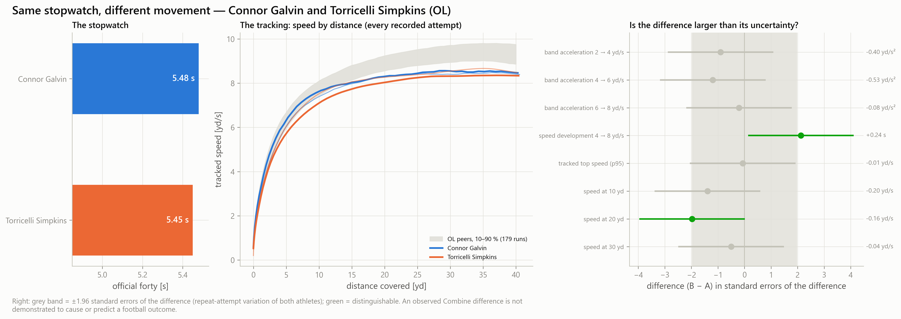

**Scout**
- *What is different:* Connor Galvin and Torricelli Simpkins (OL) ran official forty times of 5.48 s and 5.45 s — 0.03 s apart. Their official 10-yard splits are 1.81 s and 1.84 s. speed development 4 → 8 yd/s: 1.97 s versus 2.20 s — a difference of +0.24 s [+0.02, +0.45], larger than its measurement uncertainty. On this measure the observed value favours Connor Galvin. speed at 20 yd: 8.31 yd/s versus 8.15 yd/s — a difference of -0.16 yd/s [-0.32, -0.00], larger than its measurement uncertainty. On this measure the observed value favours Connor Galvin. 6 other feature(s) show a difference that is inside the measurement uncertainty and should not be read as a difference.
- *Is it measurable:* 2 of 8 tested curve features differ by more than the uncertainty of the difference (repeat-attempt variation of both athletes).
- *Film to examine:* Film — compare both prospects on pulls and climbs to the second level.
- *What remains uncertain:* Not separable on this evidence: band acceleration 2 → 4 yd/s, band acceleration 4 → 6 yd/s, band acceleration 6 → 8 yd/s, tracked top speed (p95), speed at 10 yd. An observed Combine difference is not demonstrated to cause or predict a football outcome.

**Position coach**
- *Observed movement phase:* The measured difference sits in mid-sprint speed development (about 4 to 8 yd/s).
- *Relevant physical demand:* In tracked NFL games, OL athletes show 3 'accel_mid' episodes per 100 eligible player-plays (2,208 episodes, 83 athletes): the physical demand closest to mid-sprint speed development (about 4 to 8 yd/s).
- *Targeted movement testing:* Testing — rolling-start (flying) 10-yard segments entered at a controlled speed, so the 4 → 8 yd/s band is measured directly.
- *Measurement limitations:* A suggested test is a way to measure the phase again — its usefulness for football evaluation has not been established, and no training conclusion follows from an observed difference. One drill, at maximal effort, from rest, without pads: game movement depends on role, opportunity and context.

**General manager**
- *New information beyond official tests:* speed development 4 → 8 yd/s (repeatable_beyond_official)
- *Strength of evidence:* 2 distinguishable feature(s) out of 8 tested; recording evidence tiers: high and high.
- *Redundancy:* Largely the same information as official testing: speed at 20 yd.
- *Uncertainty:* Differences are tested against repeat-attempt variation only. NFL predictive value of any tracked Combine feature: not established.
- *Does this justify additional evaluation:* Yes — as a reason for additional film review or a targeted test of the named phase. It is not an input for ranking the two prospects.

## Repeat-attempt inconsistency — Jacob Cowing vs Isaiah Bond (WR)

*Matched on:* official forty within 0.03 s, both with two attempts. *Contrast:* difference in the attempt-to-attempt range of speed development (0.46).

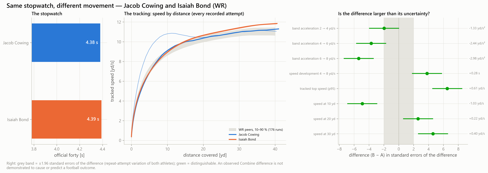

**Scout**
- *What is different:* Jacob Cowing and Isaiah Bond (WR) ran official forty times of 4.38 s and 4.39 s — 0.01 s apart. Their official 10-yard splits are 1.54 s and 1.51 s. tracked top speed (p95): 11.15 yd/s versus 11.76 yd/s — a difference of +0.61 yd/s [+0.43, +0.79], larger than its measurement uncertainty. On this measure the observed value favours Isaiah Bond. band acceleration 6 → 8 yd/s: 6.78 yd/s² versus 3.79 yd/s² — a difference of -2.98 yd/s² [-4.07, -1.90], larger than its measurement uncertainty. On this measure the observed value favours Jacob Cowing. speed at 10 yd: 9.95 yd/s versus 8.92 yd/s — a difference of -1.03 yd/s [-1.44, -0.62], larger than its measurement uncertainty. On this measure the observed value favours Jacob Cowing.
- *Is it measurable:* 6 of 8 tested curve features differ by more than the uncertainty of the difference (repeat-attempt variation of both athletes).
- *Film to examine:* Film — compare both prospects on vertical movements and long runs after the catch. Film — compare both prospects on releases at the line and the first three steps of short movements. Film — compare both prospects on the stem of intermediate movements before the break.
- *What remains uncertain:* An observed Combine difference is not demonstrated to cause or predict a football outcome.

**Position coach**
- *Observed movement phase:* The measured difference sits in late acceleration and high speed (above about 6 yd/s). The measured difference sits in early acceleration (first steps, below about 4 yd/s). The measured difference sits in mid-sprint speed development (about 4 to 8 yd/s).
- *Relevant physical demand:* In tracked NFL games, WR athletes show 1 'transition_high' episodes per 100 eligible player-plays (545 episodes, 68 athletes): the physical demand closest to late acceleration and high speed (above about 6 yd/s). In tracked NFL games, WR athletes show 97 'accel_low' episodes per 100 eligible player-plays (35,679 episodes, 83 athletes): the physical demand closest to early acceleration (first steps, below about 4 yd/s). In tracked NFL games, WR athletes show 7 'accel_mid' episodes per 100 eligible player-plays (2,520 episodes, 80 athletes): the physical demand closest to mid-sprint speed development (about 4 to 8 yd/s).
- *Targeted movement testing:* Testing — a longer sprint or flying 20-yard segment, because 40 yards can end before top speed is reached. Testing — timed starts over 0–5 and 0–10 yd with split timing, at least two repetitions, recorded from before the first movement. Testing — rolling-start (flying) 10-yard segments entered at a controlled speed, so the 4 → 8 yd/s band is measured directly.
- *Measurement limitations:* A suggested test is a way to measure the phase again — its usefulness for football evaluation has not been established, and no training conclusion follows from an observed difference. One drill, at maximal effort, from rest, without pads: game movement depends on role, opportunity and context. Recording evidence is below the high tier for Jacob Cowing: read the comparison with that in mind.

**General manager**
- *New information beyond official tests:* tracked top speed (p95) (repeatable_beyond_official) band acceleration 6 → 8 yd/s (moderately_repeatable_partly_beyond_stopwatch) speed at 10 yd (moderately_repeatable_partly_beyond_stopwatch) speed development 4 → 8 yd/s (repeatable_beyond_official)
- *Strength of evidence:* 6 distinguishable feature(s) out of 8 tested; recording evidence tiers: medium and high.
- *Redundancy:* Largely the same information as official testing: speed at 30 yd, speed at 20 yd.
- *Uncertainty:* Differences are tested against repeat-attempt variation only. NFL predictive value of any tracked Combine feature: not established.
- *Does this justify additional evaluation:* Yes — as a reason for additional film review or a targeted test of the named phase. It is not an input for ranking the two prospects.

## Tracking-quality limitation — Jonathan Mingo vs Luke McCaffrey (WR)

*Matched on:* official forty within 0.03 s, evidence tier high versus low. *Contrast:* closest official forty first (0.00).

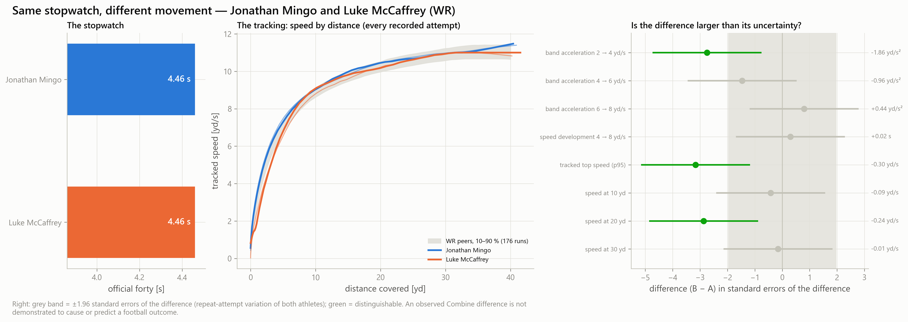

**Scout**
- *What is different:* Jonathan Mingo and Luke McCaffrey (WR) ran official forty times of 4.46 s and 4.46 s — 0.00 s apart. Their official 10-yard splits are 1.54 s and 1.52 s. tracked top speed (p95): 11.30 yd/s versus 11.00 yd/s — a difference of -0.30 yd/s [-0.48, -0.11], larger than its measurement uncertainty. On this measure the observed value favours Jonathan Mingo. speed at 20 yd: 10.44 yd/s versus 10.20 yd/s — a difference of -0.24 yd/s [-0.41, -0.08], larger than its measurement uncertainty. On this measure the observed value favours Jonathan Mingo. 5 other feature(s) show a difference that is inside the measurement uncertainty and should not be read as a difference.
- *Is it measurable:* 2 of 8 tested curve features differ by more than the uncertainty of the difference (repeat-attempt variation of both athletes).
- *Film to examine:* Film — compare both prospects on vertical movements and long runs after the catch. Film — compare both prospects on the stem of intermediate movements before the break.
- *What remains uncertain:* Not separable on this evidence: band acceleration 4 → 6 yd/s, band acceleration 6 → 8 yd/s, speed development 4 → 8 yd/s, speed at 10 yd, speed at 30 yd. An observed Combine difference is not demonstrated to cause or predict a football outcome.

**Position coach**
- *Observed movement phase:* The measured difference sits in late acceleration and high speed (above about 6 yd/s). The measured difference sits in mid-sprint speed development (about 4 to 8 yd/s).
- *Relevant physical demand:* In tracked NFL games, WR athletes show 1 'transition_high' episodes per 100 eligible player-plays (545 episodes, 68 athletes): the physical demand closest to late acceleration and high speed (above about 6 yd/s). In tracked NFL games, WR athletes show 7 'accel_mid' episodes per 100 eligible player-plays (2,520 episodes, 80 athletes): the physical demand closest to mid-sprint speed development (about 4 to 8 yd/s).
- *Targeted movement testing:* Testing — a longer sprint or flying 20-yard segment, because 40 yards can end before top speed is reached. Testing — rolling-start (flying) 10-yard segments entered at a controlled speed, so the 4 → 8 yd/s band is measured directly.
- *Measurement limitations:* A suggested test is a way to measure the phase again — its usefulness for football evaluation has not been established, and no training conclusion follows from an observed difference. One drill, at maximal effort, from rest, without pads: game movement depends on role, opportunity and context. Recording evidence is below the high tier for Luke McCaffrey: read the comparison with that in mind.

**General manager**
- *New information beyond official tests:* tracked top speed (p95) (repeatable_beyond_official)
- *Strength of evidence:* 2 distinguishable feature(s) out of 8 tested; recording evidence tiers: high and low.
- *Redundancy:* Largely the same information as official testing: speed at 20 yd.
- *Uncertainty:* Differences are tested against repeat-attempt variation only. NFL predictive value of any tracked Combine feature: not established.
- *Does this justify additional evaluation:* Yes — as a reason for additional film review or a targeted test of the named phase. It is not an input for ranking the two prospects.

## Tracking-quality limitation — Julius Brents vs Ryan Watts (DB)

*Matched on:* official forty within 0.03 s, evidence tier high versus low. *Contrast:* closest official forty first (0.00).

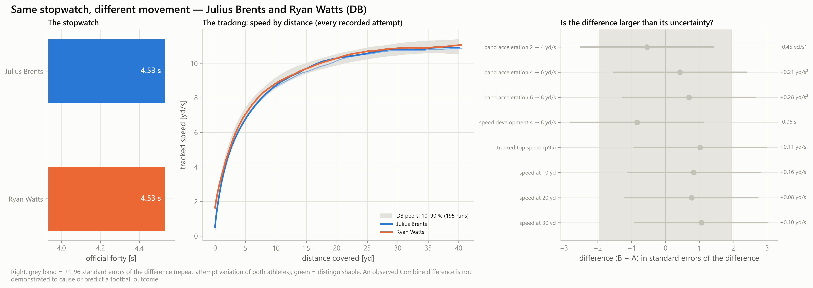

**Scout**
- *What is different:* Julius Brents and Ryan Watts (DB) ran official forty times of 4.53 s and 4.53 s — 0.00 s apart. Their official 10-yard splits are 1.57 s and 1.55 s. No tracked curve feature separates them beyond its measurement uncertainty: on the recorded evidence the two runs are not distinguishable.
- *Is it measurable:* 0 of 8 tested curve features differ by more than the uncertainty of the difference (repeat-attempt variation of both athletes).
- *Film to examine:* No specific film prompt from tracking.
- *What remains uncertain:* Not separable on this evidence: band acceleration 2 → 4 yd/s, band acceleration 4 → 6 yd/s, band acceleration 6 → 8 yd/s, speed development 4 → 8 yd/s, tracked top speed (p95). An observed Combine difference is not demonstrated to cause or predict a football outcome.

**Position coach**
- *Observed movement phase:* No movement phase is separated beyond measurement uncertainty.
- *Relevant physical demand:* No NFL demand profile is attached to this comparison.
- *Targeted movement testing:* None indicated by tracking.
- *Measurement limitations:* A suggested test is a way to measure the phase again — its usefulness for football evaluation has not been established, and no training conclusion follows from an observed difference. One drill, at maximal effort, from rest, without pads: game movement depends on role, opportunity and context. Recording evidence is below the high tier for Ryan Watts: read the comparison with that in mind.

**General manager**
- *New information beyond official tests:* None that is both distinguishable and not already carried by the stopwatch.
- *Strength of evidence:* 0 distinguishable feature(s) out of 8 tested; recording evidence tiers: high and low.
- *Redundancy:* No distinguishable feature of this pair is flagged as stopwatch-redundant.
- *Uncertainty:* Differences are tested against repeat-attempt variation only. NFL predictive value of any tracked Combine feature: not established.
- *Does this justify additional evaluation:* No — tracking adds nothing here that justifies additional evaluation beyond official testing and film.

## Similar movement, observed NFL movement shown — Caleb Murphy vs Braden Fiske (DL)

*Matched on:* official forty within 0.03 s, no distinguishable curve feature, both with ≥ 50 tracked NFL windows. *Contrast:* smallest largest-|z| (most similar measured movement) (0.40).

**Scout**
- *What is different:* Caleb Murphy and Braden Fiske (DL) ran official forty times of 4.81 s and 4.78 s — 0.03 s apart. Their official 10-yard splits are 1.65 s and 1.68 s. No tracked curve feature separates them beyond its measurement uncertainty: on the recorded evidence the two runs are not distinguishable.
- *Is it measurable:* 0 of 8 tested curve features differ by more than the uncertainty of the difference (repeat-attempt variation of both athletes).
- *Film to examine:* No specific film prompt from tracking.
- *What remains uncertain:* Not separable on this evidence: band acceleration 2 → 4 yd/s, band acceleration 4 → 6 yd/s, band acceleration 6 → 8 yd/s, speed development 4 → 8 yd/s, tracked top speed (p95). An observed Combine difference is not demonstrated to cause or predict a football outcome.
- *Observed NFL movement (post-draft, illustration):* Observed NFL movement, shown after the selection and not used for it — Caleb Murphy: 3.63 yd/s² over 161 windows; Braden Fiske: 3.14 yd/s² over 1144 windows. Two athletes cannot show a relationship; this is an illustration of what was observed, in whichever direction it points.

**Position coach**
- *Observed movement phase:* No movement phase is separated beyond measurement uncertainty.
- *Relevant physical demand:* No NFL demand profile is attached to this comparison.
- *Targeted movement testing:* None indicated by tracking.
- *Measurement limitations:* A suggested test is a way to measure the phase again — its usefulness for football evaluation has not been established, and no training conclusion follows from an observed difference. One drill, at maximal effort, from rest, without pads: game movement depends on role, opportunity and context.

**General manager**
- *New information beyond official tests:* None that is both distinguishable and not already carried by the stopwatch.
- *Strength of evidence:* 0 distinguishable feature(s) out of 8 tested; recording evidence tiers: high and high.
- *Redundancy:* No distinguishable feature of this pair is flagged as stopwatch-redundant.
- *Uncertainty:* Differences are tested against repeat-attempt variation only. NFL predictive value of any tracked Combine feature: not established.
- *Does this justify additional evaluation:* No — tracking adds nothing here that justifies additional evaluation beyond official testing and film.
- *Observed NFL movement (post-draft, illustration):* Observed NFL movement, shown after the selection and not used for it — Caleb Murphy: 3.63 yd/s² over 161 windows; Braden Fiske: 3.14 yd/s² over 1144 windows. Two athletes cannot show a relationship; this is an illustration of what was observed, in whichever direction it points.

## Similar movement, observed NFL movement shown — Tyler Guyton vs Joe Huber (OL)

*Matched on:* official forty within 0.03 s, no distinguishable curve feature, both with ≥ 50 tracked NFL windows. *Contrast:* smallest largest-|z| (most similar measured movement) (0.44).

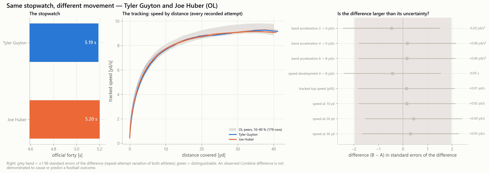

**Scout**
- *What is different:* Tyler Guyton and Joe Huber (OL) ran official forty times of 5.19 s and 5.20 s — 0.01 s apart. Their official 10-yard splits are 1.76 s and 1.80 s. No tracked curve feature separates them beyond its measurement uncertainty: on the recorded evidence the two runs are not distinguishable.
- *Is it measurable:* 0 of 8 tested curve features differ by more than the uncertainty of the difference (repeat-attempt variation of both athletes).
- *Film to examine:* No specific film prompt from tracking.
- *What remains uncertain:* Not separable on this evidence: band acceleration 2 → 4 yd/s, band acceleration 4 → 6 yd/s, band acceleration 6 → 8 yd/s, speed development 4 → 8 yd/s, tracked top speed (p95). An observed Combine difference is not demonstrated to cause or predict a football outcome.
- *Observed NFL movement (post-draft, illustration):* Observed NFL movement, shown after the selection and not used for it — Tyler Guyton: 2.69 yd/s² over 1240 windows; Joe Huber: 2.69 yd/s² over 75 windows. Two athletes cannot show a relationship; this is an illustration of what was observed, in whichever direction it points.

**Position coach**
- *Observed movement phase:* No movement phase is separated beyond measurement uncertainty.
- *Relevant physical demand:* No NFL demand profile is attached to this comparison.
- *Targeted movement testing:* None indicated by tracking.
- *Measurement limitations:* A suggested test is a way to measure the phase again — its usefulness for football evaluation has not been established, and no training conclusion follows from an observed difference. One drill, at maximal effort, from rest, without pads: game movement depends on role, opportunity and context.

**General manager**
- *New information beyond official tests:* None that is both distinguishable and not already carried by the stopwatch.
- *Strength of evidence:* 0 distinguishable feature(s) out of 8 tested; recording evidence tiers: high and high.
- *Redundancy:* No distinguishable feature of this pair is flagged as stopwatch-redundant.
- *Uncertainty:* Differences are tested against repeat-attempt variation only. NFL predictive value of any tracked Combine feature: not established.
- *Does this justify additional evaluation:* No — tracking adds nothing here that justifies additional evaluation beyond official testing and film.
- *Observed NFL movement (post-draft, illustration):* Observed NFL movement, shown after the selection and not used for it — Tyler Guyton: 2.69 yd/s² over 1240 windows; Joe Huber: 2.69 yd/s² over 75 windows. Two athletes cannot show a relationship; this is an illustration of what was observed, in whichever direction it points.

