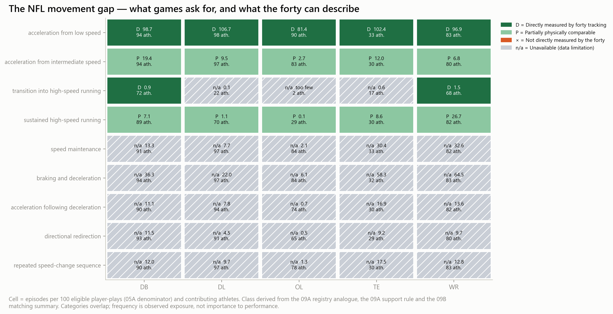

# NFL Movement Gap — executive summary

_Generated 2026-10-14T14:24:12Z from mart `warehouse/gold/advanced_movement/intelligence_v1/app_mart/v1` (built 2026-10-14T13:13:05Z, run mode full)._

- The forty-yard dash is one straight-line acceleration from rest. Across 416,507 observed NFL movement episodes, the 09A atlas defines 9 speed-change demands; 9 have a physical analogue in forty tracking and 0 have none ().
- DB: 0 % of the summed exposure rate falls in demands the forty does not describe (0.0 of 210.1 episodes per 100 eligible player-plays; 63,914 eligible player-plays).
- DL: 0 % of the summed exposure rate falls in demands the forty does not describe (0.0 of 169.2 episodes per 100 eligible player-plays; 50,363 eligible player-plays).
- OL: 0 % of the summed exposure rate falls in demands the forty does not describe (0.0 of 94.9 episodes per 100 eligible player-plays; 82,806 eligible player-plays).
- TE: 0 % of the summed exposure rate falls in demands the forty does not describe (0.0 of 255.8 episodes per 100 eligible player-plays; 8,124 eligible player-plays).
- WR: 0 % of the summed exposure rate falls in demands the forty does not describe (0.0 of 265.0 episodes per 100 eligible player-plays; 36,836 eligible player-plays).
- Largest gap: WR — the position whose observed game movement the forty describes least, by this exposure index.
- Categories overlap, so the exposure index is not a share of distinct movements; frequency is exposure, not importance to performance.
- A proposed test is a candidate way to measure a demand the forty does not describe. Its value for evaluating NFL prospects has not been established and would need prospective evidence.

## Exposure index by coverage class

| Position | Not described by the forty | Direct | Partial | Not measured | Eligible player-plays |
|---|---|---|---|---|---|
| DB | 0 % | 99.6 | 26.4 | 0.0 | 63,914 |
| DL | 0 % | 106.7 | 10.6 | 0.0 | 50,363 |
| OL | 0 % | 81.4 | 2.7 | 0.0 | 82,806 |
| TE | 0 % | 102.4 | 20.5 | 0.0 | 8,124 |
| WR | 0 % | 98.3 | 33.5 | 0.0 | 36,836 |

## Candidate measurements

- **DB · Rolling-start acceleration** — enter a 10-yd zone at a controlled 4 yd/s and accelerate maximally; measures the 4 → 8 yd/s band from a rolling start (for acceleration from intermediate speed, 19.4 per 100 eligible player-plays).
- **DB · Flying sprint** — a flying 20-yd segment after a 20–30-yd build-up, so top speed is reached and held inside the recording (for sustained high-speed running, 7.1 per 100 eligible player-plays).
- **DB · DB movement sequence** — backpedal → plant (brake) → drive at 45° → close over 5–15 yd; tracked at ≥ 10 Hz with the same band and braking rules as the NFL atlas (for position-specific movement sequence, combines the demands above).
- **DL · Rolling-start acceleration** — enter a 10-yd zone at a controlled 4 yd/s and accelerate maximally; measures the 4 → 8 yd/s band from a rolling start (for acceleration from intermediate speed, 9.5 per 100 eligible player-plays).
- **DL · Flying sprint** — a flying 20-yd segment after a 20–30-yd build-up, so top speed is reached and held inside the recording (for sustained high-speed running, 1.1 per 100 eligible player-plays).
- **DL · DL movement sequence** — get-off from stance → 2-yd burst → redirect toward the quarterback → close; tracked at ≥ 10 Hz with the same band and braking rules as the NFL atlas (for position-specific movement sequence, combines the demands above).
- **OL · Rolling-start acceleration** — enter a 10-yd zone at a controlled 4 yd/s and accelerate maximally; measures the 4 → 8 yd/s band from a rolling start (for acceleration from intermediate speed, 2.7 per 100 eligible player-plays).
- **OL · Flying sprint** — a flying 20-yd segment after a 20–30-yd build-up, so top speed is reached and held inside the recording (for sustained high-speed running, 0.1 per 100 eligible player-plays).
- **OL · OL movement sequence** — pull or set from stance → short burst over 3–5 yd → redirect to the second level; tracked at ≥ 10 Hz with the same band and braking rules as the NFL atlas (for position-specific movement sequence, combines the demands above).
- **TE · Rolling-start acceleration** — enter a 10-yd zone at a controlled 4 yd/s and accelerate maximally; measures the 4 → 8 yd/s band from a rolling start (for acceleration from intermediate speed, 12.0 per 100 eligible player-plays).
- **TE · Flying sprint** — a flying 20-yd segment after a 20–30-yd build-up, so top speed is reached and held inside the recording (for sustained high-speed running, 8.6 per 100 eligible player-plays).
- **TE · TE movement sequence** — release from an attached stance → seam stem → brake → redirect → re-accelerate; tracked at ≥ 10 Hz with the same band and braking rules as the NFL atlas (for position-specific movement sequence, combines the demands above).
- **WR · Flying sprint** — a flying 20-yd segment after a 20–30-yd build-up, so top speed is reached and held inside the recording (for sustained high-speed running, 26.7 per 100 eligible player-plays).
- **WR · Rolling-start acceleration** — enter a 10-yd zone at a controlled 4 yd/s and accelerate maximally; measures the 4 → 8 yd/s band from a rolling start (for acceleration from intermediate speed, 6.8 per 100 eligible player-plays).
- **WR · WR movement sequence** — release → stem at intermediate speed → brake → break at 45–90° → re-accelerate; tracked at ≥ 10 Hz with the same band and braking rules as the NFL atlas (for position-specific movement sequence, combines the demands above).

_A proposed test is a candidate way to measure a demand the forty does not describe. Its value for evaluating NFL prospects has not been established and would need prospective evidence._

