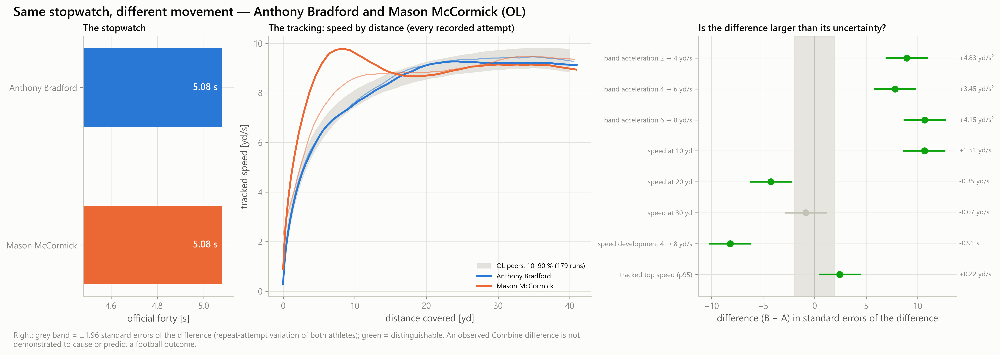
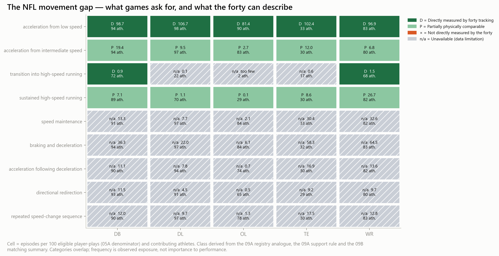
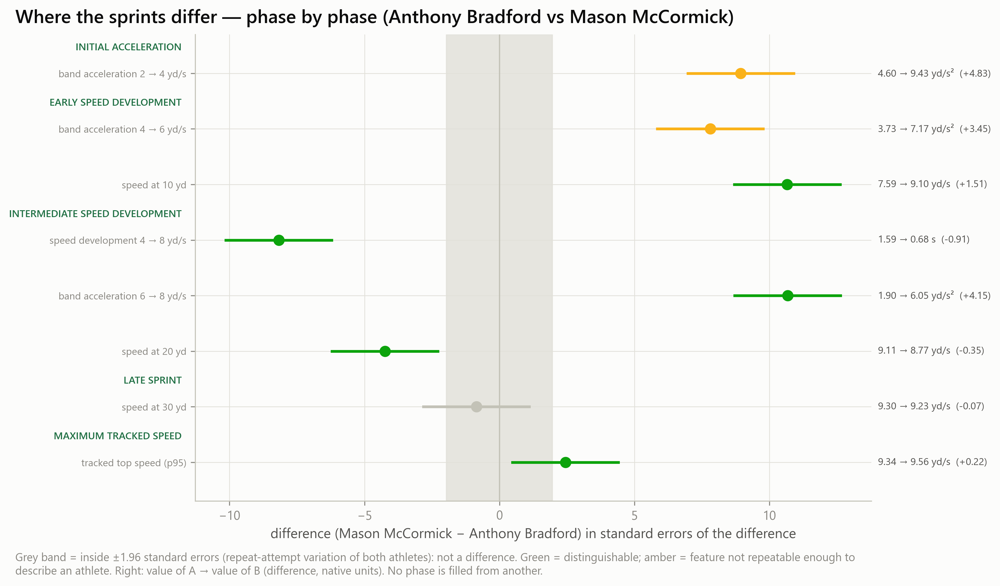
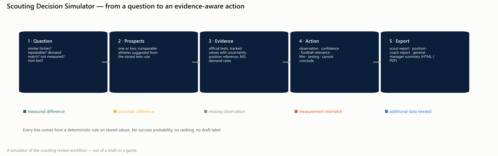

# Same Stopwatch. Different Movement.

## What 10 Hz Combine Tracking Reveals About NFL Prospects — and How Scouts Can Use It

*NFL Big Data Bowl 2027 · Combine Intelligence Lab · document rendered 2026-10-14T14:25:56Z from application mart v1 (built 2026-10-14T13:13:05Z, run mode full).*

> **Number provenance.** Milestone 09 numbers below are typed from `reports/milestone09/EXECUTED_NUMBERS.md` (executed 2026-10-14) and re-checked against the mart by notebook 10E. Earlier-milestone results are the executed 08B.6 evidence claims (C01–C20). Values marked ‹M10:…› are filled by notebook 10E from the executed 10B and 10C outputs.

---

## The opening

Anthony Bradford and Mason McCormick are both offensive linemen. Both ran the forty in **5.08 seconds**. On a draft board, that cell reads the same.

Their 10 Hz tracking does not. Through the 2 → 4 yd/s band of the first steps, McCormick built speed at 9.43 yd/s² and Bradford at 4.60 yd/s² — a difference of +4.83 yd/s² with a 95 % interval of [+3.77, +5.89], far outside the repeat-attempt noise of either athlete. McCormick reached 10 yards already moving at 9.10 yd/s against Bradford's 7.59. And yet by 20 yards Bradford was the one carrying more speed (9.11 vs 8.77 yd/s, difference −0.35 [−0.51, −0.19]).

Same stopwatch. Two different sprints. The question is what a scout should do with that.

---

## 1 · The problem

The Combine reduces a sprint to an endpoint. A forty time is one number for a whole run, and a 10-yard split is one more. Two athletes can reach the same time through very different speed curves — an early burst that fades, or a slow start that keeps building. The stopwatch cannot tell them apart, and it cannot see movements the forty never asks for: braking, redirecting, re-accelerating.

**Research question.** Does 10 Hz Combine tracking contain repeatable, athlete-specific movement information that the official tests do not — and if it does, how can it be used honestly in scouting when it has not been shown to predict NFL performance?

---

## 2 · The discovery — the stopwatch hides repeatable differences

**Data.** 510 Combine prospects in the application mart, 418 of them with tracked forty attempts — 793 tracked attempts in all, at 10 Hz, in five position groups (DB, DL, OL, TE, WR).

**Stopwatch twins.** We paired every two prospects of the same position whose official forties are within 0.03 s: **3,266 stopwatch-twin pairs**. For each pair and each of eight tracked curve features, the difference is tested against the repeat-attempt variation of *both* athletes (distinguishable = the 95 % interval of the difference excludes zero). **2,097 of the 3,266 pairs** differ beyond measurement uncertainty on at least one feature.

| Feature (of 3,128 tested pairs) | Share distinguishable |
|---|---|
| tracked top speed (p95) | 40.0 % |
| speed at 30 yd | 38.0 % |
| speed at 20 yd | 26.0 % |
| speed development 4 → 8 yd/s | 20.6 % |
| speed at 10 yd | 16.7 % |
| band acceleration 4 → 6 yd/s | 16.4 % |
| band acceleration 2 → 4 yd/s | 14.5 % |
| band acceleration 6 → 8 yd/s | 13.9 % |

About 5 % would be called distinguishable by chance alone. Every feature is well above that line.

**Is it repeatable, and is it new?** From the executed evidence registry (08B.6):

- Tracked top speed is highly repeatable between attempts — ICC 0.95 [0.94, 0.96] (C01) — but largely the same information as official testing: R² on the stopwatch 0.87 (C04).
- Speed development (time from 4 to 8 yd/s) is repeatable — ICC 0.82 [0.78, 0.86] — and only partly explained by the stopwatch (R² 0.65) (C02). It stays repeatable after official tests are accounted for (C17).
- Peak tangential acceleration is **not** repeatable enough to describe an athlete — ICC 0.35 [0.20, 0.49] (C03). The Lab therefore never uses it to describe a prospect.
- The whole speed-by-distance curve is low-dimensional: two FPCA components explain 97.7 % of held-out curve variance (C05).
- A learned movement fingerprint (TCN-B) recognises an athlete's repeat attempt (retrieval AUC 0.873 [0.856, 0.890], C06) — even among prospects with near-identical official results (0.796 [0.768, 0.824], C07).

So: tracking adds **repeatable** information, concentrated in *how speed is developed*, and some tracked numbers (top speed) mostly restate the stopwatch. The Lab labels each feature accordingly.

---

## 3 · The football connection — what NFL games actually ask for

Across **416,507** usable NFL movement episodes, the demand atlas (Milestone 09A) segments nine speed-change demands, with every rate expressed per 100 eligible player-plays:

| Demand (all positions) | Episodes | Per 100 eligible player-plays |
|---|---|---|
| acceleration from low speed | 228,227 | 94.3 |
| braking and deceleration | 67,836 | 28.0 |
| speed maintenance | 28,602 | 11.8 |
| acceleration from intermediate speed | 22,875 | 9.5 |
| repeated speed-change sequence | 19,799 | 8.2 |
| acceleration following deceleration | 18,001 | 7.4 |
| sustained high-speed running | 15,659 | 6.5 |
| directional redirection | 14,311 | 5.9 |
| transition into high-speed running | 1,197 | 0.5 |

Demand differs sharply by position (OL show 81 low-speed acceleration episodes per 100 player-plays, DL 107, DB 99; high-speed transitions are rare for linemen and too few for OL to describe at all).

### The NFL Movement Gap

For each position and demand we asked a rule-based question: *can forty tracking physically describe this?* — **directly** (same speed band, same start state), **partially** (same band, different state), **not at all** (no physical analogue in a straight sprint), or **unavailable** (too few observed episodes). 0 of the nine demands have no analogue in the forty: braking, re-acceleration after braking, redirection, speed maintenance and repeated speed changes.

| Position | Exposure index not described by the forty | Direct | Partial | Not measured | Eligible player-plays | Fewest athletes in a supported cell |
|---|---|---|---|---|---|---|
| DB | 0 % | 99.6 | 26.4 | 0.0 | 63,914 | 72 |
| DL | 0 % | 106.7 | 10.6 | 0.0 | 50,363 | 22 |
| OL | 0 % | 81.4 | 2.7 | 0.0 | 82,806 | 29 |
| TE | 0 % | 102.4 | 20.5 | 0.0 | 8,124 | 17 |
| WR | 0 % | 98.3 | 33.5 | 0.0 | 36,836 | 68 |

*The exposure index sums overlapping category rates; it is an index of exposure, not a share of distinct movements, and frequency is not importance to performance.*

The largest gap by the declared rule: **WR**.

---

## 4 · Three real athlete stories

Selected by pre-declared rules from pre-draft data — from the 3,266 twin pairs and the 23 case studies (10 types) of Milestone 09D. No NFL outcome entered any choice.

### Story 1 — Same speed, different development — Ladd McConkey and Isaiah Bond (WR)

*Selection:* the pair named in the brief (Ladd McConkey and Isaiah Bond) passes all six criteria.

Ladd McConkey and Isaiah Bond (WR) ran identical official forties of 4.39 s. Their 10 Hz tracking separates them on 3 of 8 measured features beyond measurement uncertainty; the largest is tracked top speed (p95): 10.93 yd/s versus 11.76 yd/s. The difference sits in late acceleration and high speed (above about 6 yd/s), mid-sprint speed development (about 4 to 8 yd/s). That makes it a specific question for film and a targeted test — not a verdict on either player, because no tracked Combine feature has shown NFL predictive value here.

- Pair: Ladd McConkey and Isaiah Bond (WR) · distinguishable: 3 of 8 tested features · largest: tracked top speed (p95): 10.93 yd/s vs 11.76 yd/s.

The brief proposed Ladd McConkey and Isaiah Bond (WR, both 4.39 s). In the 09D gallery their tracked differences are real — top speed 10.93 vs 11.76 yd/s, +0.84 [+0.65, +1.02] — but sit in features largely carried by the stopwatch (speed at 20 and 30 yd), and McConkey's recording is in the low evidence tier. That is exactly why Story 1 uses a written rule rather than a name.

### Story 2 — Same forty, different curve — Anthony Bradford and Mason McCormick (OL)

Anthony Bradford and Mason McCormick (OL) ran identical official forties of 5.08 s. Their 10 Hz tracking separates them on 5 of 8 measured features beyond measurement uncertainty; the largest is band acceleration 6 → 8 yd/s: 1.90 yd/s² versus 6.05 yd/s². The difference sits in late acceleration and high speed (above about 6 yd/s), early acceleration (first steps, below about 4 yd/s). That makes it a specific question for film and a targeted test — not a verdict on either player, because no tracked Combine feature has shown NFL predictive value here.

The full measured comparison (09D, executed):

| Feature | Bradford | McCormick | Difference [95 % interval] |
|---|---|---|---|
| band acceleration 2 → 4 yd/s | 4.598 | 9.427 | +4.829 [+3.770, +5.889] yd/s² |
| band acceleration 4 → 6 yd/s | 3.726 | 7.171 | +3.445 [+2.580, +4.310] yd/s² |
| band acceleration 6 → 8 yd/s | 1.897 | 6.048 | +4.151 [+3.389, +4.914] yd/s² |
| speed at 10 yd | 7.593 | 9.103 | +1.510 [+1.232, +1.787] yd/s |
| speed at 20 yd | 9.113 | 8.766 | −0.347 [−0.507, −0.187] yd/s |
| speed development 4 → 8 yd/s | 1.592 | 0.683 | −0.909 [−1.127, −0.691] s |
| tracked top speed (p95) | 9.337 | 9.557 | +0.220 [+0.043, +0.397] yd/s |

This demonstrates *informational* difference — two distinct ways to run a 5.08 — not football importance. McCormick's recording is below the high evidence tier, which the Lab displays beside every number.

### Story 3 — The movement gap — what the forty cannot see for WR

For WR, 0 % of observed NFL movement exposure falls in demands the forty-yard dash cannot physically describe. The forty describes straight-line acceleration from rest well; braking, redirection and re-acceleration are outside it. Scouts should judge those on film now, and a short tracked deceleration or re-acceleration test is the candidate measurement — its value is unproven.

---

## 5 · The solution — Combine Intelligence Lab

A Streamlit application that reads only the precomputed, versioned application mart. In under a minute a scout can:

**Select a prospect → find comparable athletes → see the precise movement difference → check its reliability → see the physically related NFL demand → see what the forty does not measure → generate specific follow-up questions → export a report.**

| View | What it answers |
|---|---|
| Overview | the signature comparison, the three questions, what the data cover |
| Prospect Intelligence | official tests, every recorded attempt (speed vs time and distance, acceleration vs speed), uncertainty, position context |
| Stopwatch Twins | ranked comparables under the stored rule, a synchronized 10 Hz replay (time or distance), phase-by-phase differences, reliability vs redundancy |
| NFL Movement Demands | rates per 100 eligible player-plays, intensity distributions, real episode replays |
| NFL Movement Gap | the coverage matrix, two-position comparison with exposure flags, candidate tests |
| Movement Match Lab | where a Combine value sits inside the position's game demand — descriptive only |
| Scouting Decision Simulator | question → prospects → evidence → structured action → scout / coach / GM report (HTML, PDF) |
| Signature Stories | the three stories with provenance |
| Research Evidence | reliability, redundancy, FPCA, TCN-B, both transfer studies, limits — in plain language |

The simulator's output always has six parts — **Observation · Confidence · Potential football relevance · Next film review · Additional testing · Cannot conclude** — and labels every line as a *measured difference*, *uncertain difference*, *missing observation*, *measurement mismatch* or *additional data needed*. No grade, ranking, probability or draft label exists anywhere in the product, and a wording guard enforces it.

---

## 6 · The evidence — and its boundary

We tested, twice, whether tracking adds NFL predictive value beyond the official Combine tests:

- **NFL movement (Milestone 06).** TCN-B did not improve held-out prediction of NFL sustained acceleration beyond official testing: Δ RMSE +0.0003 [−0.0008, +0.0015], +0.16 % of the official-model error (C08). NFL movement windows are dominated by context: the athlete accounts for 6.3 % [5.0, 7.2] of within-position window variance (C09).
- **Football outcome (Milestone 08B, exploratory).** Receiver separation is a reliable athlete-level quantity (odd/even game reliability 0.74, C11), but engineered speed development did not improve its prediction (Δ RMSE −0.0007 [−0.0093, +0.0082], C14) and TCN-B was worse than the official model (C15).
- **Detectability.** Only large incremental effects were detectable in these cohorts (C10, C16); a future study would need roughly 500 athletes for 0.78 power at a 5 % planted share of residual variance (C20).

**No established NFL outcome prediction gain from any tested tracking representation.** We do not claim one, and the product is built so it cannot imply one.

---

## 7 · Practical applications

1. **Break ties the stopwatch cannot.** When two prospects share a time, the Lab says whether they share a sprint — and in which phase they do not.
2. **Aim the film session.** Each measured difference maps to position-specific film situations (e.g. OL: first steps of a pull or a set; DB: closing from depth over 5–15 yd).
3. **Name the missing measurement.** For demands the forty cannot see, the Lab proposes candidate tracked tests — deceleration, acceleration after controlled braking, reactive change of direction, repeated accelerations, position-specific sequences — explicitly as measurement proposals whose value is unproven.
4. **Keep the board honest.** Every number carries its uncertainty, its redundancy with the stopwatch, and the standing statement that its NFL predictive value is not established.

---

## 8 · Scientific limits

- One maximal sprint from rest, without pads; NFL movement is usually submaximal and context-driven.
- 10 Hz sampling: the 2 → 4 yd/s band spans few frames; peak acceleration is not repeatable (C03).
- A recording can start after the first movement or end before top speed; the official time remains the timed result.
- Stopwatch-twin pairs share athletes and are not independent; the distinguishable shares are descriptive, not a test.
- Demand categories overlap; rates are exposure, not importance. Vendor definitions of some football outcomes are inferred (08B is exploratory); get-off could not be used (C19).
- Physical similarity to an NFL demand is not a validated ability to meet it.

---

## 9 · Conclusion

High-frequency Combine tracking measures something the stopwatch does not: *how* an athlete builds speed, repeatably. It does not — on the evidence we could gather — predict NFL performance better than the official tests. Those two findings are not in tension. Together they define a useful tool: one that shows scouts what two identical times hide, where in a game that difference might matter physically, what the forty cannot see at all, and exactly what to watch and test next.

**Same stopwatch. Different movement. Better scouting questions.**

---

*Reproduce: `reports/milestone10/REPRODUCIBILITY.md` · figures: `reports/milestone10/FIGURE_INDEX.md` · technical detail: `reports/milestone10/TECHNICAL_APPENDIX.md` · executive brief: `reports/milestone10/EXECUTIVE_SCOUTING_BRIEF.md`.*
